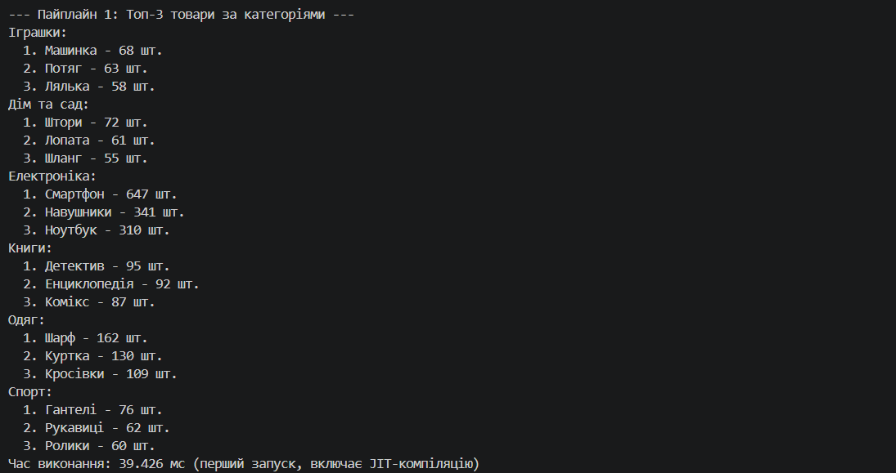
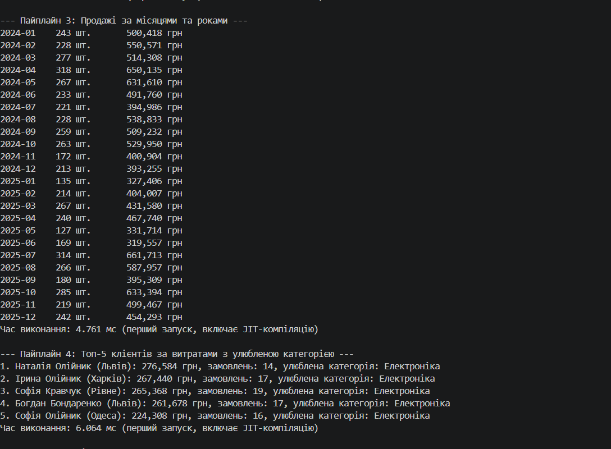
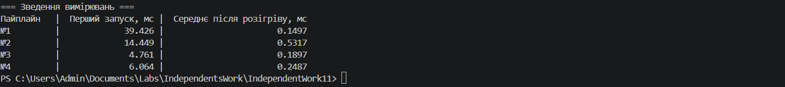
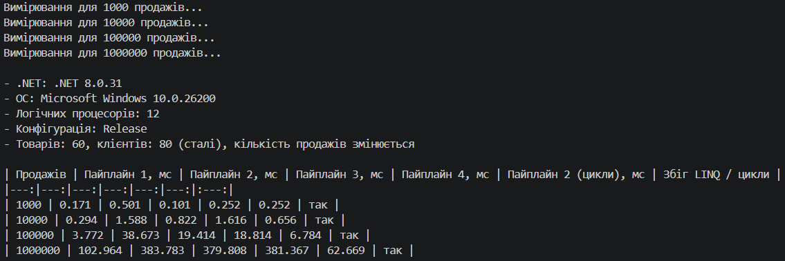

# Самостійна робота №11. LINQ-пайплайни: аналіз продажів

**Проєкт:** `IndependentWork11` (консольний застосунок C#, .NET 8)

Звіт з описом пайплайнів, вимірюваннями та висновками: **[REPORT.md](REPORT.md)**.

---

## Що реалізовано

Сценарій **«Продажі»**: три колекції та чотири LINQ-пайплайни аналітики.

| Колекція | Поля | Кількість |
|----------|------|-----------|
| `Sale` | `Id`, `ProductId`, `Quantity`, `SaleDate`, `CustomerId` | 1000 (у режимі вимірювання до 1 000 000) |
| `Product` | `Id`, `Name`, `Category`, `UnitPrice` | 60 (6 категорій по 10) |
| `Customer` | `Id`, `Name`, `City` | 80 (8 міст) |

Дані генеруються `Random` з фіксованим seed 42, тож набір однаковий під час кожного запуску (`DataGenerator.cs`).

| № | Пайплайн | Ключові оператори LINQ |
|---|----------|------------------------|
| 1 | Топ-3 товари в кожній категорії | `GroupBy`, `Select`, `Join`, `OrderByDescending`, `ThenBy`, `Take` |
| 2 | Дохід за містами клієнтів | `Join` (двічі), `GroupBy`, `Sum`, `Count`, `OrderByDescending` |
| 3 | Продажі за місяцями й роками | `Join`, `GroupBy` за складеним ключем, `Sum`, `OrderBy`, `ThenBy` |
| 4 | Топ-5 клієнтів за витратами з улюбленою категорією (власний) | `Join`, `GroupBy` зі вкладеним `GroupBy`, `OrderByDescending`, `Take`, `Join` |

Додатково для порівняння реалізовано пайплайн 2 **без LINQ** (цикли й словники): `Pipelines.RevenueByCityManual`.

Час кожного пайплайну вимірюється через `Stopwatch`. Пайплайни повертають матеріалізований `List<T>` (`ToList`), тому вимірюється реальне виконання, а не побудова відкладеного запиту. Друк результатів у вимірювання не входить.

---

### Скріншот

 

### Скріншот вимірювання

s