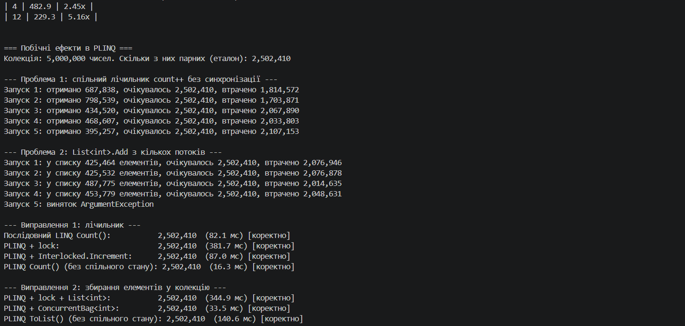
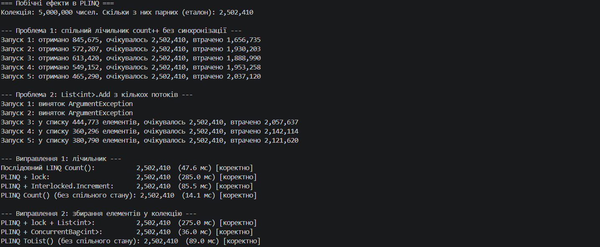

# Самостійна робота №12. PLINQ: дослідження продуктивності та безпеки

**Предмет:** Об'єктно-орієнтоване програмування

Звіт з експериментами, аналізом і висновками: **[REPORT.md](REPORT.md)**.

---

## Що реалізовано

| Файл | Призначення |
|------|-------------|
| `Operations.cs` | три операції над колекцією: перевірка на просте число, складні математичні перетворення, дешева контрольна операція |
| `PerformanceExperiments.cs` | генерація даних (`Random`, seed 42), запуск LINQ і PLINQ, вимірювання `Stopwatch`, таблиці Markdown |
| `SideEffectsDemo.cs` | демонстрація помилок через спільний стан у PLINQ та їх виправлення |
| `Program.cs` | режими запуску й збереження результатів у `benchmark-results.md` |

### Експерименти

| Експеримент | Що змінюється | Що вимірюється |
|-------------|---------------|----------------|
| 1 | розмір колекції (1M, 5M, 10M чисел) × три операції | час звичайного LINQ (`.Where().Select()`) і PLINQ (`.AsParallel().Where().Select()`), прискорення, збіг результатів |
| 2 | кількість потоків (`WithDegreeOfParallelism`) для найважчої операції | час і прискорення відносно LINQ |
| 3 | спосіб доступу до спільного стану | помилки (лічильник `count++`, `List<int>.Add`) і їх виправлення (`lock`, `Interlocked`, `ConcurrentBag`, агрегація без спільного стану) |

Методика вимірювання: розігрів JIT на невеликій колекції, примусове збирання сміття перед запуском, середнє за 3 запуски. Результати LINQ і PLINQ перевіряються на збіг (кількість і сума елементів; порядок у PLINQ без `AsOrdered` не гарантований).

---

### Скріншоти

![Скріншот порівняння продуктивності]

![Скріншот побічних ефектів]
