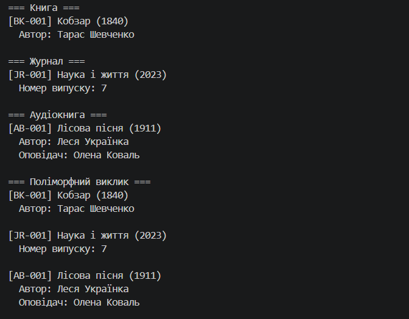

# Самостійна робота №4. Розширення ієрархії та наслідки змін базового класу

**Предмет:** Об'єктно-орієнтоване програмування
**Виконав:** _[ПІБ студента]_
**Проєкт:** `IndependentWork4` (консольний застосунок C#, .NET 8)

---

## 1. Опис задачі

Система управління бібліотекою має ієрархію `LibraryItem` → `Book`, `Journal`. У роботі виконано:

1. початкову ієрархію `LibraryItem`, `Book`, `Journal`;
2. зміну базового класу (поле й властивість `UniqueId`) та аналіз її наслідків;
3. розширення ієрархії новим класом `AudioBook`, що успадковується від `Book`.


### Діаграма класів

```
LibraryItem
 ├── Book
 │    └── AudioBook
 └── Journal
```

| Клас | Поля | Властивості | Конструктор (остаточний) |
|------|------|-------------|--------------------------|
| `LibraryItem` | `_title`, `_publicationYear`, `_uniqueId` | `Title`, `PublicationYear`, `UniqueId` (read-only) | `LibraryItem(title, publicationYear, uniqueId)` |
| `Book` | `_author` | `Author` | `Book(title, publicationYear, author, uniqueId)` |
| `Journal` | `_issueNumber` | `IssueNumber` | `Journal(title, publicationYear, issueNumber, uniqueId)` |
| `AudioBook` | `_narrator` | `Narrator` | `AudioBook(title, publicationYear, author, narrator, uniqueId)` |

---

## 2. Початкова ієрархія (кроки 2-3)

Перша версія, яка компілювалась **до** зміни базового класу:

```csharp
public class LibraryItem
{
    private string _title;
    private int _publicationYear;

    public string Title { get { return _title; } set { _title = value; } }
    public int PublicationYear { get { return _publicationYear; } set { _publicationYear = value; } }

    public LibraryItem(string title, int publicationYear)
    {
        _title = title;
        _publicationYear = publicationYear;
    }

    public virtual void DisplayDetails()
    {
        Console.WriteLine($"{_title} ({_publicationYear})");
    }
}

public class Book : LibraryItem
{
    private string _author;
    public string Author { get { return _author; } set { _author = value; } }

    public Book(string title, int publicationYear, string author)
        : base(title, publicationYear)
    {
        _author = author;
    }

    public override void DisplayDetails()
    {
        base.DisplayDetails();
        Console.WriteLine($"  Автор: {_author}");
    }
}

public class Journal : LibraryItem
{
    private int _issueNumber;
    public int IssueNumber { get { return _issueNumber; } set { _issueNumber = value; } }

    public Journal(string title, int publicationYear, int issueNumber)
        : base(title, publicationYear)
    {
        _issueNumber = issueNumber;
    }

    public override void DisplayDetails()
    {
        base.DisplayDetails();
        Console.WriteLine($"  Номер випуску: {_issueNumber}");
    }
}
```

У `DisplayDetails()` похідні класи викликають `base.DisplayDetails()` і лише **доповнюють** вивід своїми даними, а не дублюють код базового класу.

---

## 3. Зміна базового класу (крок 4)

До `LibraryItem` додано приватне поле `_uniqueId`, властивість `UniqueId` лише для читання та новий параметр конструктора:

```diff
 public class LibraryItem
 {
     private string _title;
     private int _publicationYear;
+    private readonly string _uniqueId;

     ...
+    public string UniqueId
+    {
+        get { return _uniqueId; }
+    }

-    public LibraryItem(string title, int publicationYear)
+    public LibraryItem(string title, int publicationYear, string uniqueId)
     {
         _title = title;
         _publicationYear = publicationYear;
+        _uniqueId = uniqueId;
     }

     public virtual void DisplayDetails()
     {
-        Console.WriteLine($"{_title} ({_publicationYear})");
+        Console.WriteLine($"[{_uniqueId}] {_title} ({_publicationYear})");
     }
 }
```

### Що зламалося одразу після зміни

Після зміни конструктора `LibraryItem` проєкт **перестав компілюватися**: дві помилки, по одній у `Book` і `Journal`.

```
error CS7036: There is no argument given that corresponds to the required parameter
'uniqueId' of 'LibraryItem.LibraryItem(string, int, string)'
```

### Які зміни довелося внести в похідні класи

**`Book`:**

```diff
-public Book(string title, int publicationYear, string author)
-    : base(title, publicationYear)
+public Book(string title, int publicationYear, string author, string uniqueId)
+    : base(title, publicationYear, uniqueId)
```

**`Journal`:**

```diff
-public Journal(string title, int publicationYear, int issueNumber)
-    : base(title, publicationYear)
+public Journal(string title, int publicationYear, int issueNumber, string uniqueId)
+    : base(title, publicationYear, uniqueId)
```

Також було змінено **виклики конструкторів у `Main`**: у кожен `new Book(...)` і `new Journal(...)` довелося додати ідентифікатор.

### Чому ці зміни були необхідні

1. **Конструктор базового класу не успадковується.** Похідний клас сам відповідає за виклик конструктора батька через `: base(...)`. Раніше існував конструктор з двома параметрами, а тепер лишився тільки з трьома, тож виклик `base(title, publicationYear)` більше не відповідає жодному конструктору.
2. **Похідний клас мусить звідкись узяти `uniqueId`.** Базовий клас не знає, який ідентифікатор призначити. Єдине місце, де він може з'явитися, це параметри конструктора `Book` і `Journal`, а отже, і код, який їх створює.
3. **Змінився публічний контракт усієї ієрархії.** Одна зміна в базовому класі «пройшла каскадом» через `Book`, `Journal` і код, що створює їх об'єкти.

### Альтернатива, яка не ламає похідні класи

Щоб не чіпати `Book` і `Journal`, можна було зберегти старий конструктор і згенерувати ідентифікатор автоматично:

```csharp
public LibraryItem(string title, int publicationYear)
    : this(title, publicationYear, Guid.NewGuid().ToString())
{
}
```

Тоді старий код продовжив би працювати. Завдання вимагало саме нового параметра, тому в проєкті використано основний варіант.

---

## 4. Розширення ієрархії (крок 5)

Новий клас `AudioBook` успадковується від `Book`, а не від `LibraryItem` напряму: аудіокнига є різновидом книги, тому автор і логіка виводу автора береться з `Book`.

```csharp
public class AudioBook : Book
{
    private string _narrator;

    public string Narrator
    {
        get { return _narrator; }
        set { _narrator = value; }
    }

    public AudioBook(string title, int publicationYear, string author, string narrator, string uniqueId)
        : base(title, publicationYear, author, uniqueId)
    {
        _narrator = narrator;
    }

    public override void DisplayDetails()
    {
        base.DisplayDetails(); // Book -> LibraryItem
        Console.WriteLine($"  Оповідач: {_narrator}");
    }
}
```

**Важливо:** щоб додати `AudioBook`, **жоден існуючий клас змінювати не довелося**. Параметр `uniqueId` проходить ланцюжком `AudioBook` → `Book` → `LibraryItem`. Це різниця між розширенням і модифікацією, яку розглянуто в розділі 5.

Ланцюжок викликів `DisplayDetails()` для `AudioBook`:

```
AudioBook.DisplayDetails()
 └─ base.DisplayDetails()      // Book
     └─ base.DisplayDetails()  // LibraryItem  -> [ID] Назва (рік)
     └─ друк автора            // Book
 └─ друк оповідача             // AudioBook
```

---

## 5. Аналіз: наслідування, розширення та модифікація

### Розширення проти модифікації

| | Модифікація базового класу (`UniqueId`) | Розширення новим класом (`AudioBook`) |
|---|---|---|
| Що змінюється | наявний код `LibraryItem` | додається новий файл |
| Вплив на існуючі класи | **ламає** `Book`, `Journal` і їх виклики | не впливає на інші класи |
| Ризик | високий | низький |
| Відповідність принципу OCP | порушує | відповідає |

Принцип **Open/Closed (OCP)**: клас має бути відкритим для розширення, але закритим для модифікації. `AudioBook` додано без змін у решті коду. А зміна `LibraryItem` торкнулась усіх нащадків.

### Переваги наслідування

- **Повторне використання коду:** `Title`, `PublicationYear` і базовий вивід написано один раз.
- **Поліморфізм:** колекцію `List<LibraryItem>` можна обробляти однаково, а кожен об'єкт сам виведе свої дані через `DisplayDetails()`.
- **Проста модель предметної області:** відношення «є» (`AudioBook` є `Book`, `Book` є `LibraryItem`) природно описує бібліотеку.
- **Легке розширення:** новий тип елемента додається новим класом.

### Недоліки наслідування

- **Тісний зв'язок (tight coupling):** похідні класи залежать від реалізації базового, що показала зміна `UniqueId`.
- **Ефект доміно:** зміна конструктора або поведінки предка зачіпає всю гілку нащадків.
- **Глибока ієрархія:** ланцюжок `AudioBook` → `Book` → `LibraryItem` складніше читати й налагоджувати.
- **Жорстка структура:** клас успадковується від одного предка, тому поєднати кілька різнорідних ролей непросто.

### Коли наслідування доцільне, а коли ні

**Доцільне**, коли:
- між типами є справжнє відношення «є», і воно стабільне;
- похідні класи можна підставити замість базового, не порушуючи логіку (принцип підстановки Лісков);
- базовий клас рідко змінюється.

**Може призвести до проблем**, коли:
- наслідують лише заради повторного використання коду, хоча відношення «є» немає;
- базовий клас часто змінюється;
- ієрархія глибока або розгалужується за кількома ознаками одночасно (наприклад, формат × тематика × носій).

### Композиція замість наслідування

Для цієї задачі композиція була б кращою, якщо **способів надання матеріалу** стане багато, наприклад друкований, електронний і аудіоформат. Замість класів `AudioBook`, `EBook`, `PrintedAudioBook` тощо можна створити клас `Book`, який *містить* об'єкт формату:

```csharp
public class Book : LibraryItem
{
    private IFormat _format; // PrintedFormat, AudioFormat(narrator), EBookFormat ...
    ...
}
```

Тоді нова комбінація властивостей додається без нового класу в ієрархії, а формат можна змінити під час виконання програми. Для невеликої ієрархії з трьох-чотирьох класів, як у цій роботі, наслідування простіше й зрозуміліше. Композиція виправдовує себе, коли ієрархія росте.

### Скріншот




