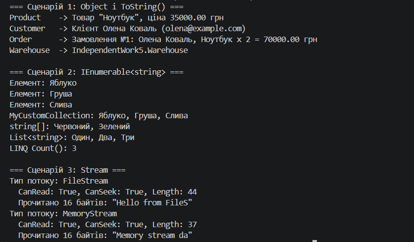

# Самостійна робота №5. Приклади поліморфізму в .NET

**Проєкт:** `IndependentWork5` (консольний застосунок C#, .NET 8)

---

## 1. Мета та структура проєкту

Дослідити, як поліморфізм працює в стандартних бібліотеках .NET на трьох прикладах:

| № | Сценарій | Механізм поліморфізму |
|---|----------|-----------------------|
| 1 | `System.Object` і `ToString()` | віртуальний метод базового класу |
| 2 | `IEnumerable<string>` | інтерфейс |
| 3 | `System.IO.Stream` | абстрактний клас |

```
IndependentWork5/
├── IndependentWork5.csproj
├── Program.cs               // демонстрація всіх трьох сценаріїв
├── Product.cs               // сценарій 1
├── Customer.cs              // сценарій 1
├── Order.cs                 // сценарій 1
├── Warehouse.cs             // сценарій 1 (без override ToString)
├── MyCustomCollection.cs    // сценарій 2
└── README.md
```

Тестовий файл `test.txt` для сценарію 3 створюється самою програмою через `File.WriteAllText`, тож зовнішні файли не потрібні.

---

## 2. Сценарій 1: поліморфізм через `System.Object`

### Реалізація

Кожен клас у C# неявно успадковується від `System.Object`, а той має віртуальний метод `ToString()`. Створено три класи (`Product`, `Customer`, `Order`), у кожному з яких метод перевизначено:

```csharp
public class Product
{
    public string Name { get; }
    public decimal Price { get; }
    // ...
    public override string ToString()
    {
        return $"Товар \"{Name}\", ціна {Price:F2} грн";
    }
}
```

Для порівняння додано клас `Warehouse` **без** перевизначення `ToString()`.

Усі об'єкти додано в одну колекцію `List<object>`:

```csharp
List<object> items = new List<object> { product, customer, order, warehouse };

foreach (object item in items)
{
    Console.WriteLine($"{item.GetType().Name,-10} -> {item}");
}
```

### Результат і аналіз

```
Product    -> Товар "Ноутбук", ціна 35000.00 грн
Customer   -> Клієнт Олена Коваль (olena@example.com)
Order      -> Замовлення №1: Олена Коваль, Ноутбук x 2 = 70000.00 грн
Warehouse  -> IndependentWork5.Warehouse
```

- Змінна `item` має **статичний** тип `object`, але **фактичний** (динамічний) тип різний: `Product`, `Customer`, `Order`, `Warehouse`.
- Під час виконання викликається `ToString()` саме **того класу, до якого належить об'єкт**. Це пізнє зв'язування (late binding) через таблицю віртуальних методів.
- Для `Product`, `Customer` і `Order` спрацювали наші перевизначення.
- Для `Warehouse` перевизначення немає, тому викликалась **успадкована реалізація `Object.ToString()`**. Вона повертає повне ім'я типу `IndependentWork5.Warehouse`, а це малокорисно. Звідси висновок: метод `ToString()` варто перевизначати.
- Методи `Equals()` і `GetHashCode()` також віртуальні й успадковані від `Object`. Їх можна перевизначити так само (наприклад, щоб порівнювати товари за назвою).

### Переваги поліморфізму в цьому сценарії

- **Однорідна обробка різних типів:** одна колекція `List<object>` і один цикл замість окремих для кожного класу.
- **Гнучкість:** `Console.WriteLine`, `string.Format`, відладчик та інші частини .NET викликають `ToString()`, нічого не знаючи про наші класи. Достатньо перевизначити метод.
- **Розширюваність:** новий клас можна додати в колекцію без зміни коду циклу.

---

## 3. Сценарій 2: поліморфізм через `IEnumerable<string>`

### Реалізація

Клас `MyCustomCollection` містить внутрішній `List<string>` і реалізує `IEnumerable<string>`. Для цього потрібно реалізувати два методи: узагальнений `GetEnumerator()` та неузагальнений явний `IEnumerable.GetEnumerator()`:

```csharp
public class MyCustomCollection : IEnumerable<string>
{
    private readonly List<string> _items = new List<string>();

    public void Add(string item) => _items.Add(item);

    public IEnumerator<string> GetEnumerator()
    {
        foreach (string item in _items)
        {
            yield return item;
        }
    }

    IEnumerator IEnumerable.GetEnumerator() => GetEnumerator();
}
```

Використання `foreach` і один метод для різних колекцій:

```csharp
MyCustomCollection collection = new MyCustomCollection();
collection.Add("Яблуко");
collection.Add("Груша");
collection.Add("Слива");

foreach (string fruit in collection)
{
    Console.WriteLine($"Елемент: {fruit}");
}

static void PrintAll(string title, IEnumerable<string> source)
{
    Console.WriteLine($"{title}: {string.Join(", ", source)}");
}

PrintAll("MyCustomCollection", collection);
PrintAll("string[]", new[] { "Червоний", "Зелений" });
PrintAll("List<string>", new List<string> { "Один", "Два", "Три" });
```

### Результат і аналіз

```
Елемент: Яблуко
Елемент: Груша
Елемент: Слива
MyCustomCollection: Яблуко, Груша, Слива
string[]: Червоний, Зелений
List<string>: Один, Два, Три
LINQ Count(): 3
```

- `foreach` не знає, що саме він перебирає: він викликає `GetEnumerator()` в об'єкта, а потім `MoveNext()` і `Current` в отриманого перелічувача.
- Метод `PrintAll` приймає `IEnumerable<string>`, тому працює і з нашою колекцією, і з масивом, і зі списком. Він залежить від **інтерфейсу**, а не від конкретного типу.
- Оскільки `MyCustomCollection` реалізує `IEnumerable<string>`, до неї автоматично застосовуються методи **LINQ** (`Count()`, `Where()`, `Select()` тощо).

### Переваги поліморфізму в цьому сценарії

- **Єдиний спосіб перебору** для масивів, списків, словників і власних колекцій.
- **Повторне використання коду:** методи, що приймають `IEnumerable<T>`, не треба переписувати для кожного типу колекції.
- **Слабкий зв'язок (loose coupling):** внутрішню структуру `MyCustomCollection` можна замінити (наприклад, `List` на масив), і клієнтський код не зміниться.
- **Доступ до LINQ** без додаткових зусиль.

---

## 4. Сценарій 3: поліморфізм через абстрактний клас `Stream`

### Реалізація

`System.IO.Stream` є абстрактним класом, від якого успадковуються `FileStream`, `MemoryStream`, `NetworkStream`, `GZipStream` та інші. Метод `ProcessStream` приймає параметр **базового** типу `Stream`:

```csharp
static void ProcessStream(Stream stream)
{
    Console.WriteLine($"Тип потоку: {stream.GetType().Name}");

    string length = stream.CanSeek ? stream.Length.ToString() : "невідомо";
    Console.WriteLine($"  CanRead: {stream.CanRead}, CanSeek: {stream.CanSeek}, Length: {length}");

    byte[] buffer = new byte[16];
    int bytesRead = stream.Read(buffer, 0, buffer.Length);
    string text = Encoding.ASCII.GetString(buffer, 0, bytesRead);

    Console.WriteLine($"  Прочитано {bytesRead} байтів: \"{text}\"");
}
```

Виклик для двох різних потоків:

```csharp
string filePath = "test.txt";
File.WriteAllText(filePath, "Hello from FileStream! Polymorphism in .NET.");

using (FileStream fileStream = new FileStream(filePath, FileMode.Open, FileAccess.Read))
{
    ProcessStream(fileStream);
}

byte[] data = Encoding.ASCII.GetBytes("Memory stream data for ProcessStream.");
using (MemoryStream memoryStream = new MemoryStream(data))
{
    ProcessStream(memoryStream);
}
```

### Результат і аналіз

```
Тип потоку: FileStream
  CanRead: True, CanSeek: True, Length: 44
  Прочитано 16 байтів: "Hello from FileS"
Тип потоку: MemoryStream
  CanRead: True, CanSeek: True, Length: 37
  Прочитано 16 байтів: "Memory stream da"
```

- `Stream` містить абстрактні та віртуальні члени (`Read`, `Write`, `Length`, `CanSeek` та ін.), які кожен нащадок реалізує **по-своєму**: `FileStream` читає з диска, `MemoryStream` бере дані з масиву в пам'яті.
- Метод `ProcessStream` написано **один раз** і він нічого не знає про те, звідки беруться дані. Виклик `stream.Read(...)` направляється до реалізації фактичного типу.
- Перевірка `CanSeek` захищає від винятку для потоків, що не підтримують `Length` (наприклад, мережевих).
- Створити об'єкт абстрактного класу `Stream` напряму неможливо, але змінна типу `Stream` може посилатися на об'єкт будь-якого нащадка.

### Переваги поліморфізму в цьому сценарії

- **Один код для різних джерел даних:** файл, пам'ять, мережа, архів.
- **Легке тестування:** замість `FileStream` у тестах можна підставити `MemoryStream`.
- **Розширюваність:** новий тип потоку (власний нащадок `Stream`) працюватиме з усім наявним кодом, що приймає `Stream`.
- **Композиція потоків:** `BufferedStream`, `GZipStream` обгортають інший `Stream`, бо всі вони мають однаковий інтерфейс.

---

## 5. Порівняння трьох сценаріїв

| | Object | IEnumerable | Stream |
|---|---|---|---|
| Що є «спільним типом» | клас `object` | інтерфейс | абстрактний клас |
| Спільна дія | `ToString()` | `foreach` / `GetEnumerator()` | `Read()` / `Write()` |
| Клієнтський код | `Console.WriteLine` | `foreach`, `PrintAll` | `ProcessStream` |
| Реалізація в нащадках | `override` (необов'язково) | обов'язкова | обов'язкова для абстрактних членів |

**Загальний висновок:** у всіх трьох випадках клієнтський код працює з **абстракцією** (`object`, `IEnumerable<string>`, `Stream`), а конкретна поведінка визначається типом об'єкта під час виконання. Це дає гнучкість і повторне використання коду, а нові типи додаються без змін у вже написаному коді.

---

### Скріншот
![Скріншот виконання програми]

---
