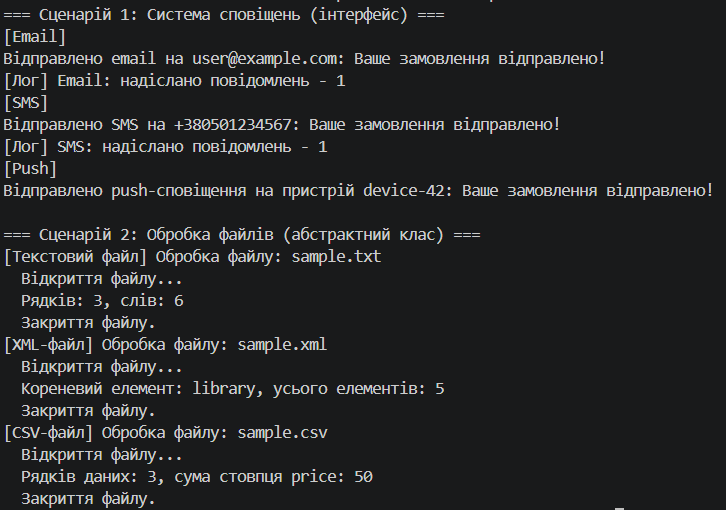

# Самостійна робота №6. Інтерфейс vs абстрактний клас: практичні критерії


**Проєкт:** `IndependentWork6` (консольний застосунок C#, .NET 8)

---

---

## Сценарій 1: Система сповіщень

### Обраний підхід: Інтерфейс `INotifier`

### Обґрунтування вибору

| Характеристика сценарію | Що вказує |
|-------------------------|-----------|
| Канали (Email, SMS, Push) мають **унікальну** логіку надсилання | немає спільного коду, який можна винести в базовий клас |
| Спільне лише **один метод** `Send(string message)` | потрібен лише контракт |
| Канали можуть мати різну додаткову поведінку (логування тощо) | потрібна комбінація поведінок |

Тому в цьому сценарії краще використовувати інтерфейс `INotifier`, оскільки:

1. **Немає спільної реалізації.** Email, SMS і Push надсилають повідомлення зовсім по-різному (SMTP, шлюз оператора, сервіс push-сповіщень). Базовому класу не було б що зберігати чи реалізовувати, залишилися б лише абстрактні методи, тобто той самий контракт.
2. **Множинна поведінка.** У C# клас може успадковувати **лише один** клас, але реалізувати **будь-яку кількість** інтерфейсів. У проєкті `EmailNotifier` і `SmsNotifier` реалізують ще й `ILoggable`, а `PushNotifier` ні. Із базовим класом `Notifier` довелося б або додавати логування всім, або вигадувати окремі гілки ієрархії.
3. **Слабке зв'язування (принцип DIP).** Клієнтський код залежить від абстракції `INotifier`, а не від конкретних класів. Новий канал (Telegram, Viber) додається без змін у коді, що надсилає повідомлення.
4. **Незалежні типи.** Канали не пов'язані відношенням «є різновидом», вони лише виконують схожу дію. Це типова ознака для інтерфейсу.

### Чому абстрактний клас тут менш доречний

- Він займає **єдине місце в успадкуванні**: клас, який уже успадковує `Notifier`, не зможе мати іншого предка (наприклад, службового базового класу).
- Він змушує створювати **штучну ієрархію** для типів, які між собою нічого спільного не мають, крім назви методу.
- Він тісніше пов'язує нащадків з базовим класом: зміна в `Notifier` зачіпає всіх (це показала самостійна №4).
- Спільного коду, заради якого абстрактний клас міг би бути корисним, немає.

### Реалізація

```csharp
// Інтерфейс
public interface INotifier
{
    string ChannelName { get; }
    void Send(string message);
}

// Додаткова поведінка
public interface ILoggable
{
    void WriteLog();
}

// Реалізація 1: два інтерфейси одразу
public class EmailNotifier : INotifier, ILoggable
{
    private readonly string _address;
    private int _sentCount;

    public string ChannelName => "Email";

    public EmailNotifier(string address) { _address = address; }

    public void Send(string message)
    {
        Console.WriteLine($"Відправлено email на {_address}: {message}");
        _sentCount++;
    }

    public void WriteLog()
    {
        Console.WriteLine($"[Лог] {ChannelName}: надіслано повідомлень - {_sentCount}");
    }
}

// Реалізація 3: лише INotifier
public class PushNotifier : INotifier
{
    private readonly string _deviceId;

    public string ChannelName => "Push";

    public PushNotifier(string deviceId) { _deviceId = deviceId; }

    public void Send(string message)
    {
        Console.WriteLine($"Відправлено push-сповіщення на пристрій {_deviceId}: {message}");
    }
}
```

`SmsNotifier` аналогічний до `EmailNotifier` (повний код у файлі `SmsNotifier.cs`).

### Демонстрація в `Main`

```csharp
List<INotifier> notifiers = new List<INotifier>
{
    new EmailNotifier("user@example.com"),
    new SmsNotifier("+380501234567"),
    new PushNotifier("device-42")
};

foreach (INotifier notifier in notifiers)
{
    Console.WriteLine($"[{notifier.ChannelName}]");
    notifier.Send("Ваше замовлення відправлено!");

    if (notifier is ILoggable loggable)
    {
        loggable.WriteLog();
    }
}
```

**Поліморфізм:** змінна `notifier` має тип `INotifier`, а `Send` виконується за правилами конкретного класу. Перевірка `is ILoggable` показує, що додаткова поведінка є не в усіх каналів.

---

## Сценарій 2: Обробка файлів

### Обраний підхід: Абстрактний клас `FileProcessor`

### Обґрунтування вибору

| Характеристика сценарію | Що вказує |
|-------------------------|-----------|
| Усі обробники мають **однакові кроки** (відкрити, закрити) | є спільний код, який не хочеться дублювати |
| Порядок кроків **фіксований**: відкрити → обробити → закрити | потрібно захистити послідовність |
| Унікальним є лише **обробка вмісту** | один абстрактний метод |
| Усі обробники є різновидами «обробника файлів» | є справжнє відношення «є» |

Тому в цьому сценарії краще використовувати абстрактний клас `FileProcessor`, оскільки:

1. **Спільна реалізація.** Відкриття (`Open`) і закриття (`Close`) написані один раз у базовому класі. Нащадки не дублюють їх, а реалізують лише `ProcessContent`.
2. **Шаблонний метод.** Метод `Process()` не є віртуальним і задає порядок: `Open()` → `ProcessContent()` → `Close()`. Нащадок не може його порушити, наприклад, забути закрити файл. Закриття стоїть у блоці `finally`, тому виконується навіть у разі помилки.
3. **Спільний стан.** Базовий клас зберігає приватні поля (`_filePath`, `_reader`), які нащадкам не потрібні напряму. В інтерфейсі полів немає.
4. **Контрольоване розширення.** `protected virtual` дозволяє нащадкові змінити відкриття (наприклад, інше кодування) і не змінювати решту.

### Чому інтерфейс тут менш доречний

- В інтерфейсі `IFileProcessor` довелося б залишити методи `Open`, `Close` і `ProcessContent` **без реалізації**, тому кожен із трьох класів повторив би однаковий код відкриття та закриття.
- Інтерфейс **не може гарантувати порядок** викликів: код, що працює з `IFileProcessor`, мав би сам правильно викликати `Open` → `Process` → `Close`, і помилитися в цьому легко.
- Інтерфейс не зберігає стан (немає полів).
- Інтерфейс усе ж можна було б використати з методами за замовчуванням (C# 8+) або з композицією (клас-помічник для відкриття), але для такої простої задачі це складніше за один абстрактний клас.

### Реалізація

```csharp
public abstract class FileProcessor
{
    private readonly string _filePath;
    private StreamReader? _reader;

    public abstract string FileType { get; }

    protected FileProcessor(string filePath) { _filePath = filePath; }

    
    public void Process()
    {
        Console.WriteLine($"[{FileType}] Обробка файлу: {_filePath}");

        Open();
        try
        {
            ProcessContent(_reader!);
        }
        finally
        {
            Close();
        }
    }

    protected virtual void Open()
    {
        Console.WriteLine("  Відкриття файлу...");
        _reader = new StreamReader(_filePath);
    }

    protected virtual void Close()
    {
        _reader?.Dispose();
        _reader = null;
        Console.WriteLine("  Закриття файлу.");
    }

    
    protected abstract void ProcessContent(TextReader reader);
}

public class TextFileProcessor : FileProcessor
{
    public override string FileType => "Текстовий файл";

    public TextFileProcessor(string filePath) : base(filePath) { }

    protected override void ProcessContent(TextReader reader)
    {
        int lines = 0;
        int words = 0;

        string? line;
        while ((line = reader.ReadLine()) != null)
        {
            lines++;
            words += line.Split(' ', StringSplitOptions.RemoveEmptyEntries).Length;
        }

        Console.WriteLine($"  Рядків: {lines}, слів: {words}");
    }
}
```

`XmlFileProcessor` (через `XDocument.Load`) і `CsvFileProcessor` (підрахунок рядків і суми стовпця) реалізовані аналогічно, див. відповідні файли.

### Демонстрація в `Main`

```csharp
List<FileProcessor> processors = new List<FileProcessor>
{
    new TextFileProcessor("sample.txt"),
    new XmlFileProcessor("sample.xml"),
    new CsvFileProcessor("sample.csv")
};

foreach (FileProcessor processor in processors)
{
    processor.Process();
}
```

Тестові файли `sample.txt`, `sample.xml`, `sample.csv` створюються в коді перед обробкою.

**Поліморфізм:** `Process()` однаковий для всіх, але на кроці `ProcessContent` викликається реалізація конкретного нащадка.

---

## Порівняння підходів

| Критерій | Інтерфейс | Абстрактний клас |
|----------|-----------|------------------|
| Реалізація за замовчуванням | немає (лише з default-методами C# 8+) | є (`virtual`-методи) |
| Поля та стан | немає | є |
| Кількість «предків» | можна реалізувати багато | успадкувати лише один |
| Відношення між типами | «вміє» (can do) | «є» (is a) |
| Спільний код | не підтримується | підтримується |
| Захист порядку кроків | неможливий | шаблонний метод |
| Зв'язаність | слабка | сильніша |
| Зміна контракту | ламає всі реалізації | можна додати `virtual`-метод без поломок |

| Сценарій | Вибір | Головна причина |
|----------|-------|-----------------|
| Сповіщення | інтерфейс | немає спільного коду, потрібна множинна поведінка |
| Файли | абстрактний клас | спільні кроки та фіксований порядок |

---

## Загальні висновки

### Практичні критерії вибору

**Обирайте інтерфейс, коли:**
- типи не пов'язані відношенням «є», але мають виконувати спільну дію («вміє»);
- спільної реалізації немає або вона мінімальна;
- клас має поєднувати кілька ролей (`INotifier` + `ILoggable`);
- потрібна слабка зв'язаність і легке підставлення в тестах.

**Обирайте абстрактний клас, коли:**
- є справжнє відношення «є» (усі нащадки є різновидом базового типу);
- є **спільний код і стан**, який не хочеться дублювати;
- потрібно зафіксувати **порядок кроків** алгоритму (шаблонний метод);
- нащадки мають спільні поля чи конструкторську логіку.

**Можна поєднувати:** абстрактний клас може реалізувати інтерфейс і надавати його спільну частину, а нащадки доповнюють решту. Так часто організовано бібліотеки .NET.

### Як порівняння допомагає прийняти рішення

Порівняння змушує перевірити конкретні ознаки задачі (чи є спільний код, чи потрібен порядок кроків, чи є відношення «є», чи потрібна множинна поведінка), а не обирати «за звичкою». У цій роботі одні й ті самі запитання дали різні відповіді для двох сценаріїв, і кожна відповідь має практичне пояснення. Обґрунтування передує реалізації, а не підганяється під неї заднім числом.

### Роль поліморфізму

В обох сценаріях клієнтський код працює з **базовим типом** (`INotifier` або `FileProcessor`) і не знає про конкретні класи. Нові канали або формати файлів додаються без змін у наявному коді (принцип відкритості/закритості). Різниця лише в тому, що в інтерфейсі поліморфізм дає контракт, а в абстрактному класі ще й спільну поведінку.

---


### Скріншот


![Скріншот виконання програми]
