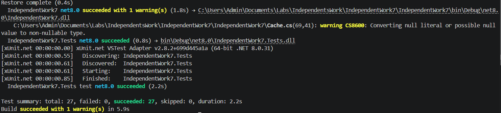
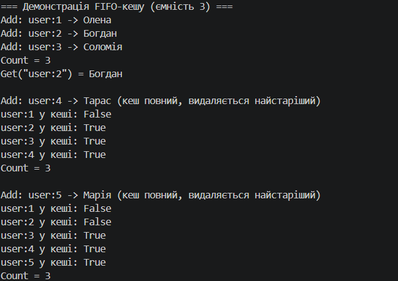

# Самостійна робота №7. Узагальнений кеш `Cache<TKey, TValue>` із тестами

**Предмет:** Об'єктно-орієнтоване програмування
**Виконав:** _[ПІБ студента]_
**Рішення:** `IndependentWork7.sln` (проєкти `IndependentWork7` та `IndependentWork7.Tests`, .NET 8)

---

## Мета

Розробити узагальнений кеш обмеженої ємності з політикою витіснення **FIFO** (First In, First Out) і покрити його юніт-тестами. Реалізовано базове рішення (`Dictionary` + `Queue`); розширення до LRU не виконувалось (воно необов'язкове).


## Реалізація `Cache<TKey, TValue>`

### Поля

| Поле | Тип | Призначення |
|------|-----|-------------|
| `_capacity` | `int` | максимальна кількість елементів |
| `_cache` | `Dictionary<TKey, TValue>` | зберігання пар «ключ-значення», пошук за O(1) |
| `_keysOrder` | `Queue<TKey>` | порядок додавання ключів; попереду стоїть найстаріший |

### Публічний інтерфейс

| Член | Опис |
|------|------|
| `Cache(int capacity)` | створює кеш; якщо `capacity <= 0`, кидає `ArgumentOutOfRangeException` |
| `void Add(TKey key, TValue value)` | додає елемент; якщо кеш повний, спершу видаляє найстаріший |
| `TValue Get(TKey key)` | повертає значення; якщо ключа немає, кидає `KeyNotFoundException` |
| `bool ContainsKey(TKey key)` | перевіряє наявність ключа |
| `int Count { get; }` | поточна кількість елементів |

### Код

```csharp
public class Cache<TKey, TValue> where TKey : notnull
{
    private readonly int _capacity;
    private readonly Dictionary<TKey, TValue> _cache;
    private readonly Queue<TKey> _keysOrder;

    public Cache(int capacity)
    {
        if (capacity <= 0)
        {
            throw new ArgumentOutOfRangeException(nameof(capacity), capacity, "Ємність кешу має бути більшою за нуль.");
        }

        _capacity = capacity;
        _cache = new Dictionary<TKey, TValue>(capacity);
        _keysOrder = new Queue<TKey>(capacity);
    }

    public int Count
    {
        get { return _cache.Count; }
    }

    public void Add(TKey key, TValue value)
    {
        if (_cache.ContainsKey(key))
        {
            _cache[key] = value;   // оновлення: черга й розмір не змінюються
            return;
        }

        if (_cache.Count >= _capacity)
        {
            TKey oldestKey = _keysOrder.Dequeue();  // найстаріший ключ
            _cache.Remove(oldestKey);
        }

        _cache.Add(key, value);
        _keysOrder.Enqueue(key);
    }

    public TValue Get(TKey key)
    {
        if (_cache.TryGetValue(key, out TValue value))
        {
            return value;
        }

        throw new KeyNotFoundException($"Ключ '{key}' не знайдено в кеші.");
    }

    public bool ContainsKey(TKey key)
    {
        return _cache.ContainsKey(key);
    }
}
```

### Скріншот запуску тестів

![Результат dotnet test]


## Демонстрація в `Main`

Запуск: `dotnet run --project IndependentWork7`


### Скріншот роботи програми

![Скріншот виконання програми]

---

## 6. Висновки

1. Узагальнений `Cache<TKey, TValue>` працює з будь-якими типами ключа й значення без дублювання коду (перевірено на `int`/`string`, `string`/`int` та власному типі).
2. Комбінація `Dictionary` (швидкий пошук) і `Queue` (порядок додавання) дає FIFO-витіснення з O(1) для всіх операцій.
3. Тести окремо покривають кожен публічний член, граничні випадки (ємність 1, повторне додавання ключа, витіснений ключ) і головну відмінність FIFO від LRU.
4. Для переходу на LRU замість `Queue<TKey>` потрібен `LinkedList<TKey>`: під час `Get` елемент переміщується в кінець списку, а видаляється голова списку.
