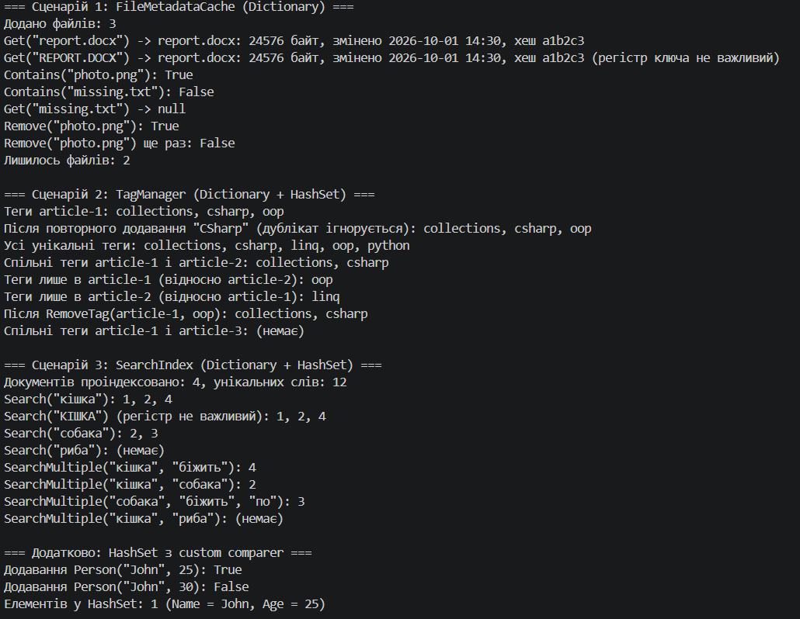

# Самостійна робота №8. Dictionary та HashSet у .NET

**Проєкт:** `IndependentWork8` (консольний застосунок C#, .NET 8)

Звіт з аналізом open-source проєктів, порівняльною таблицею складності та висновками: **[REPORT.md](REPORT.md)**.

Ключові особливості:

- імена файлів, теги та слова порівнюються **без урахування регістру** (`StringComparer.OrdinalIgnoreCase`);
- `TagManager` використовує всі три операції над множинами: `UnionWith`, `IntersectWith`, `ExceptWith`;
- `SearchIndex.SearchMultiple` знаходить документи зі **всіма** словами через перетин множин;
- методи повертають **копії** множин, щоб зовнішній код не міг змінити внутрішній стан.

---

### Скріншот

![Скріншот виконання програми]
