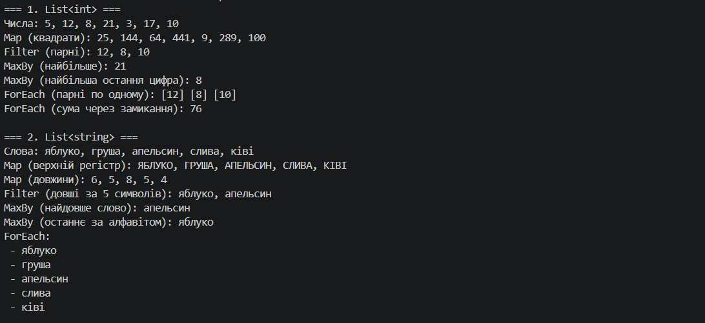
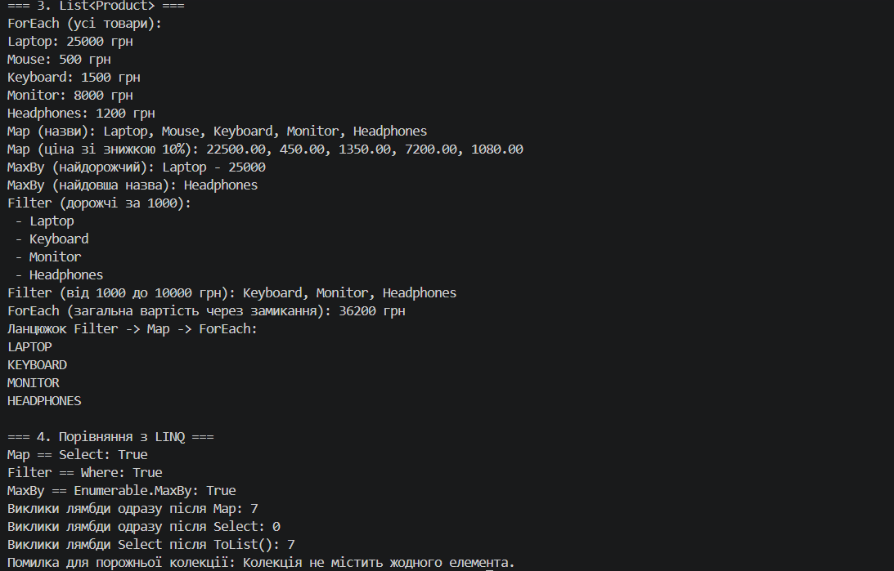

# Самостійна робота №9. Делегати й лямбда-вирази: власні утиліти для колекцій

**Проєкт:** `` (консольний застосунок C#, .NET 8)

---

## 1. Мета та структура проєкту

Створити власні узагальнені методи-утиліти для колекцій, поведінка яких передається через **делегати** та **лямбда-вирази**, і порівняти їх з вбудованим LINQ.

```csharp
public static class CollectionUtils
{
    public static IEnumerable<TResult> Map<TSource, TResult>(
        IEnumerable<TSource> collection, Func<TSource, TResult> mapper)
    {
        ArgumentNullException.ThrowIfNull(collection);
        ArgumentNullException.ThrowIfNull(mapper);

        var result = new List<TResult>();
        foreach (var item in collection)
        {
            result.Add(mapper(item));   // поведінка передається ззовні
        }
        return result;
    }

    public static IEnumerable<T> Filter<T>(IEnumerable<T> collection, Predicate<T> predicate)
    {
        ArgumentNullException.ThrowIfNull(collection);
        ArgumentNullException.ThrowIfNull(predicate);

        var result = new List<T>();
        foreach (var item in collection)
        {
            if (predicate(item))
            {
                result.Add(item);
            }
        }
        return result;
    }

    public static void ForEach<T>(IEnumerable<T> collection, Action<T> action)
    {
        ArgumentNullException.ThrowIfNull(collection);
        ArgumentNullException.ThrowIfNull(action);

        foreach (var item in collection)
        {
            action(item);
        }
    }
    // MaxBy: див. файл CollectionUtils.cs
}
```

## Демонстрація

У `Main` використано **три різні колекції**: `List<int>`, `List<string>`, `List<Product>`. Кожен метод викликається з різними лямбда-виразами.

```csharp
var products = new List<Product>
{
    new Product { Name = "Laptop", Price = 25000m },
    new Product { Name = "Mouse", Price = 500m },
    new Product { Name = "Keyboard", Price = 1500m },
    new Product { Name = "Monitor", Price = 8000m },
    new Product { Name = "Headphones", Price = 1200m }
};

var names = CollectionUtils.Map(products, p => p.Name);
var mostExpensive = CollectionUtils.MaxBy(products, p => p.Price);
var expensive = CollectionUtils.Filter(products, p => p.Price > 1000);
CollectionUtils.ForEach(expensive, p => Console.WriteLine($" - {p.Name}"));

// ForEach із замиканням: лямбда змінює локальну змінну
decimal total = 0;
CollectionUtils.ForEach(products, p => total += p.Price);

// Ланцюжок: Filter -> Map -> ForEach
CollectionUtils.ForEach(
    CollectionUtils.Map(CollectionUtils.Filter(products, p => p.Price > 1000), p => p.Name.ToUpper()),
    Console.WriteLine);
```

| Колекція | Використані лямбди |
|----------|--------------------|
| `List<int>` | `n => n * n`, `n => n % 2 == 0`, `n => n % 10`, `n => sum += n` |
| `List<string>` | `w => w.ToUpper()`, `w => w.Length`, `w => w.Length > 5`, `w => w` |
| `List<Product>` | `p => p.Name`, `p => p.Price * 0.9m`, `p => p.Price > 1000 && p.Price < 10000`, `p => total += p.Price` |

---

## Звіт

### Чому делегати корисні для створення таких утиліт?

Методи `Map`, `Filter`, `MaxBy`, `ForEach` складаються з двох частин:

- **незмінна частина**: як обійти колекцію (цикл, перевірка на `null`, збирання результату);
- **змінна частина**: що саме зробити з кожним елементом (піднести до квадрата, перевірити умову, обрати ключ).

Делегат дозволяє **передати змінну частину як параметр**. Тоді цикл пишеться один раз, а поведінка підставляється з місця виклику. Без делегатів довелося б:

- писати окремий метод для кожного випадку (`GetNames`, `GetPrices`, `FilterExpensive`, `FilterEven`...), що призводить до дублювання коду;
- або створювати інтерфейс і по класу для кожної дії (патерн «Стратегія»), що значно громіздкіше.

Додатково делегати:

- **типобезпечні**: компілятор перевіряє, що лямбда відповідає сигнатурі (`Func<T, TKey>` не прийме метод, який нічого не повертає);
- **узагальнені**: `Func<TSource, TResult>`, `Action<T>` і `Predicate<T>` підходять до будь-яких типів, тому один метод `Map` працює і з `int`, і з `string`, і з `Product`;
- **самодокументовані**: назва типу делегата показує роль (`Predicate<T>` - умова, `Action<T>` - дія, `Func<T, TResult>` - обчислення).

### Як лямбда-вирази спрощують виклик цих методів?

Один і той самий виклик `Filter` у трьох формах:

```csharp
// 1. Іменований метод: потрібно оголосити окрему функцію
static bool IsExpensive(Product p) => p.Price > 1000;
var r1 = CollectionUtils.Filter(products, IsExpensive);

// 2. Анонімний метод: багатослівно
var r2 = CollectionUtils.Filter(products, delegate (Product p) { return p.Price > 1000; });

// 3. Лямбда-вираз: коротко, умова одразу в місці використання
var r3 = CollectionUtils.Filter(products, p => p.Price > 1000);
```

Переваги лямбд:

- **Стислість:** умова читається прямо в рядку виклику, без окремих методів і імен.
- **Виведення типів:** у `CollectionUtils.Map(products, p => p.Name)` компілятор сам визначає `TSource = Product` (з першого аргумента) і `TResult = string` (з типу, який повертає лямбда). Явні `<Product, string>` не потрібні, і тип `p` писати не треба.
- **Замикання (closure):** лямбда може використовувати локальні змінні оточення. У демонстрації `CollectionUtils.ForEach(numbers, n => sum += n)` накопичує суму в змінній `sum`, оголошеній поза лямбдою. Варто пам'ятати, що лямбда захоплює **саму змінну**, а не її значення на момент створення.
- **Композиція:** лямбди легко комбінувати в ланцюжки (`Filter` → `Map` → `ForEach`).

### Порівняння власних методів з LINQ

| Власний метод | LINQ | Спільне | Відмінності |
|---------------|------|---------|-------------|
| `Map` | `Select` | однаковий результат для однакової лямбди | `Map` виконується **одразу** і повертає готовий список; `Select` **відкладено** (deferred execution) |
| `Filter` | `Where` | однаковий результат | те саме відкладене виконання в `Where`; `Filter` приймає `Predicate<T>`, `Where` приймає `Func<T, bool>` |
| `MaxBy` | `Enumerable.MaxBy` (.NET 6+) | повертає елемент з максимальним ключем | для порожньої колекції власний метод кидає `InvalidOperationException`; LINQ для типу-посилання повертає `null`, а для значення без `null` кидає виняток |
| `ForEach` | немає | | у `Enumerable` такого методу немає навмисно (LINQ не призначений для побічних ефектів). Є лише `List<T>.ForEach` |

Результати збігаються (перевірка в розділі 4 демонстрації):

```
Map == Select: True
Filter == Where: True
MaxBy == Enumerable.MaxBy: True
```

**Eager проти deferred.** Лічильник викликів лямбди показує різницю:

```csharp
int calls = 0;
var mapped = CollectionUtils.Map(numbers, n => { calls++; return n * 2; });
// calls == 5: усі елементи оброблено одразу

calls = 0;
var selected = numbers.Select(n => { calls++; return n * 2; });
// calls == 0: нічого не виконано, поки результат не переберуть
selected.ToList();
// calls == 5
```

Відкладене виконання в LINQ дозволяє будувати довгі ланцюжки без проміжних списків і зупинятися раніше (`First`, `Take`). Власні `Map` та `Filter` створюють проміжний список на кожному кроці, тому для великих даних вони менш ефективні за пам'яттю.


### Висновки

1. Делегати відокремлюють «як обходити» від «що робити» і дозволяють один раз написати узагальнений алгоритм, а потім використовувати його з будь-якою поведінкою.
2. Лямбда-вирази роблять такий виклик коротким і читабельним, а замикання дозволяють працювати з локальними змінними.
3. Власні методи дають ту саму логіку, що й LINQ, але без відкладеного виконання та оптимізацій. У реальних проєктах слід використовувати LINQ.
4. **Коли власні утиліти доцільні:** для навчання та розуміння, як працює LINQ; коли потрібна особлива семантика (негайне виконання, власна обробка порожньої колекції, логування); коли потрібен метод, якого немає в LINQ (на кшталт `ForEach` для `IEnumerable`); коли не можна підключати залежності або цільова платформа не має потрібного оператора.


### Скріншот




