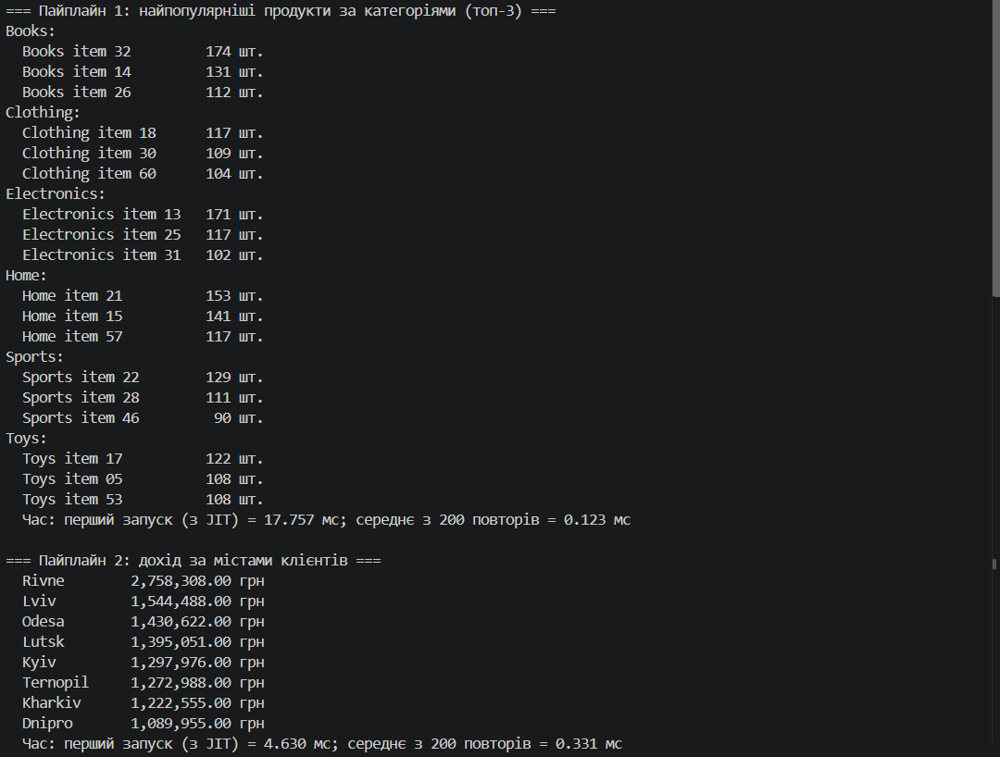
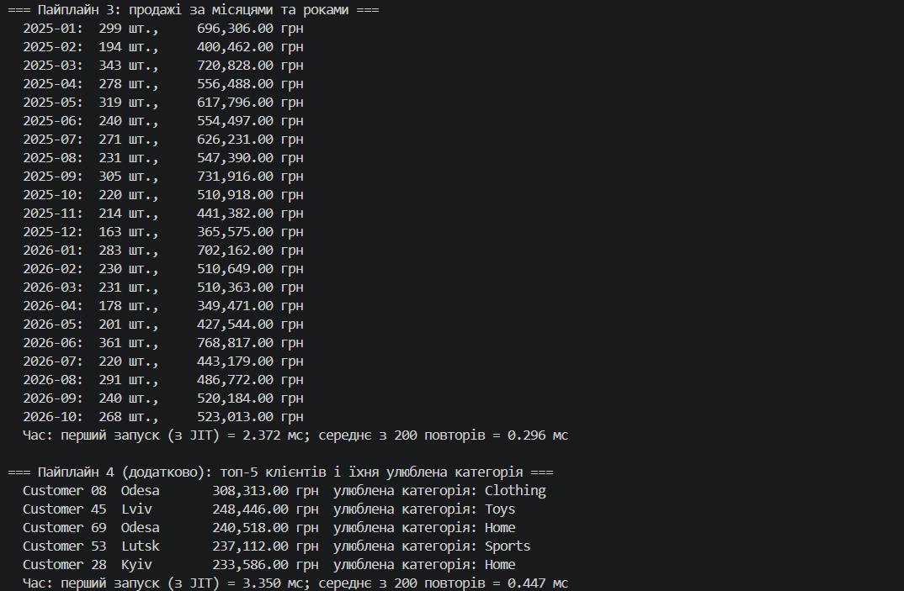

# Самостійна робота №17 (ООП)

**Тема:** LINQ pipelines: ETL та аналітика
**Проєкт:** `IndependentWork11`
**Звіт (опис пайплайнів, вимірювання, висновки):** [REPORT.md](REPORT.md)

## Що реалізовано

Сценарій «Продажі»: сутності `Sale`, `Product`, `Customer` і чотири LINQ-пайплайни.

| Пайплайн | Метод | Основні оператори |
|---|---|---|
| 1. Найпопулярніші продукти за категоріями (топ-3) | `TopProductsByCategory` | `GroupBy`, `Sum`, `Join`, `OrderBy(Descending)`, `Take` |
| 2. Дохід за містами клієнтів | `RevenueByCity` | `Join` ×2, `GroupBy`, `Sum`, `OrderByDescending` |
| 3. Продажі за місяцями й роками | `SalesByYearMonth` | `Join`, `GroupBy` (складений ключ), `Sum`, `OrderBy`/`ThenBy` |
| 4. (додатково) Топ-5 клієнтів і їхня улюблена категорія | `TopCustomersWithFavoriteCategory` | `Join`, `GroupBy` (вкладений), `Sum`, `Take` |

Дані (**Extract**) генеруються `Random` із фіксованим `Seed = 42`: 60 товарів, 80 клієнтів, 1000 продажів (січень 2025 — жовтень 2026). Кожен пайплайн вимірюється **власним** `Stopwatch`.

## Структура

```text
IndependentWork11/
├── IndependentWork11.csproj
├── Models.cs            # Sale, Product, Customer та типи результатів
├── DataGenerator.cs     # відтворювані тестові дані
├── SalesPipelines.cs    # чотири LINQ-пайплайни
├── Program.cs           # запуск, вивід, вимірювання часу
├── README.md
├── REPORT.md
└── docs/                # сюди — скриншот запуску
```
### Скриншот запуску

dotnet run(
  
  
)

## Відповіді на контрольні запитання

1. **Переваги LINQ для ETL порівняно з ручними циклами?**
   Декларативність (описуємо *що* отримати, а не *як*), менше коду та допоміжних змінних, композиція з готових кроків, однаковий синтаксис для будь-яких джерел даних.
2. **Чому `Join`, `GroupBy`, `Select`, `OrderBy` поєднують в одному пайплайні?**
   Дані нормалізовані по різних колекціях: `Join` збирає їх разом, `GroupBy` агрегує, `Select` формує потрібну форму, `OrderBy` упорядковує результат. Кожен оператор виконує один крок.
3. **Що найбільше впливає на продуктивність складних LINQ-запитів?**
   Розмір даних, кількість проходів і проміжних колекцій, вибір оператора (`Join` будує хеш-таблицю, а вкладений `Where` дає O(n·m)), аллокації (анонімні типи, ітератори), повторне обчислення відкладеного запиту, матеріалізація.
4. **Як перевірити, що пайплайн читабельний і підтримуваний?**
   Кожен пайплайн — окремий метод із промовистою назвою, невелика кількість кроків, коментарі до складних місць, відтворювані тестові дані та перевірка результату на малому наборі з відомою відповіддю.
