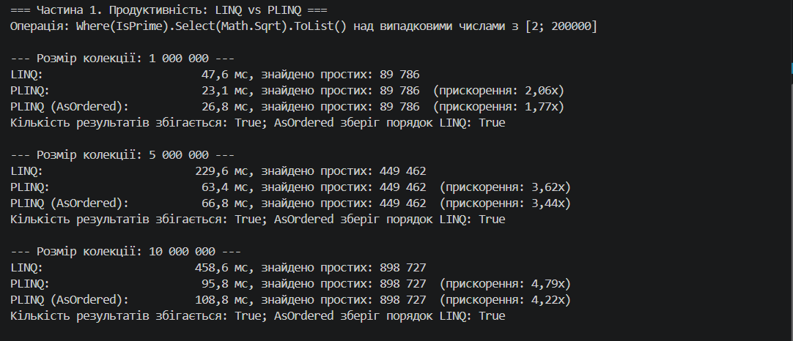
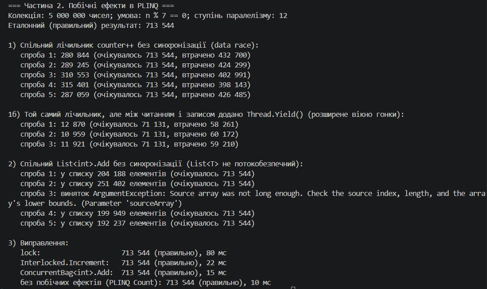

# Самостійна робота №18 (ООП)

**Тема:** PLINQ: дослідження продуктивності та безпеки
**Проєкт:** `IndependentWork12`
**Звіт (експерименти, аналіз, висновки):** [REPORT.md](REPORT.md)

## Що реалізовано

1. **Великі колекції:** `List<int>` на 1 000 000, 5 000 000 (додатково) та 10 000 000 випадкових чисел із діапазону [2; 200 000] (`Seed = 42`).
2. **Обчислювально інтенсивна операція:** `Where(IsPrime).Select(Math.Sqrt)` — перевірка на просте число методом пробного ділення O(√n).
3. **Порівняння продуктивності:** звичайний LINQ, PLINQ (`AsParallel()`) та PLINQ з `AsOrdered()`, час вимірюється `Stopwatch`; кількість результатів звіряється.
4. **Побічні ефекти в PLINQ:**
   - спільний лічильник `counter++` без синхронізації (data race);
   - той самий лічильник із `Thread.Yield()` між читанням і записом: помилка відтворюється навіть на одному ядрі;
   - спільний `List<int>.Add` з кількох потоків (`List<T>` не потокобезпечний);
   - **виправлення:** `lock`, `Interlocked.Increment`, `ConcurrentBag<int>`, а найкраще — PLINQ без побічних ефектів (`Count`).

## Структура

```text
IndependentWork12/
├── IndependentWork12.csproj
├── Program.cs
├── README.md
├── REPORT.md
└── docs/            # сюди — скриншот запуску
```
### Скриншот запуску

dotnet run (
   
   
)

## Відповіді на контрольні запитання

1. **За яких умов PLINQ зазвичай дає виграш?**
   Коли є кілька ядер процесора, операція над кожним елементом обчислювально важка (CPU-bound), елементів багато, елементи незалежні один від одного, а запит не вимагає порядку й не має побічних ефектів.
2. **Чому побічні ефекти в PLINQ дають некоректні результати?**
   Лямбда виконується одночасно в кількох потоках. Операції на кшталт `counter++` (читання, зміна, запис) не атомарні, тому потоки перезаписують зміни один одного; `List<T>` не розрахований на одночасні записи.
3. **Для чого порівнювати кілька розмірів колекції?**
   Вигода від паралелізму залежить від розміру: для малих даних накладні витрати (розбиття на частини, потоки, злиття) перевищують виграш. Один замір може ввести в оману.
4. **Що робити, якщо PLINQ виявився повільнішим?**
   Не використовувати його «за замовчуванням»: перевірити кількість ядер, вартість операції на елемент, розмір даних, наявність `AsOrdered`/синхронізації. Якщо виграшу немає, залишити звичайний LINQ як простіший і передбачуваніший.
