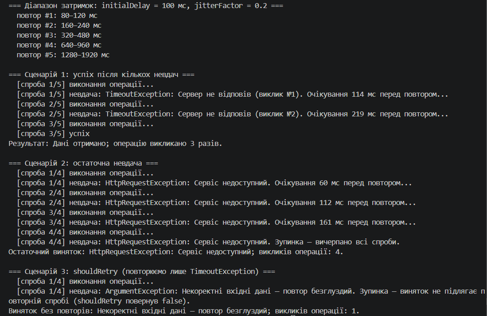

# Самостійна робота №20 (ООП)

**Тема:** Реалізація exponential backoff
**Проєкт:** `IndependentWork14`

## Мета

Розробити власний узагальнений допоміжний клас `RetryPolicy`, який виконує операцію з повторними спробами, **експоненційною затримкою** та випадковим **jitter**.

## Що реалізовано

| Елемент | Опис |
|---|---|
| Поля | `_maxRetries`, `_initialDelay`, `_jitterFactor` |
| Конструктор | `RetryPolicy(int maxRetries, TimeSpan initialDelay, double jitterFactor = 0.2)` з перевіркою аргументів |
| Метод | `T Execute<T>(Func<T> operation, Func<Exception, bool>? shouldRetry = null)` |
| Формула затримки | `delay = initialDelay * Math.Pow(2, retryAttempt) * (1 + random.NextDouble() * jitterFactor * 2 - jitterFactor)` (метод `CalculateDelay`) |
| Логування | кожна спроба, затримка і причина невдачі виводяться через `Console.WriteLine` |

Особливості реалізації:

- `maxRetries` — кількість **повторів**, тому загалом операція виконується до `maxRetries + 1` разів.
- Коли спроби вичерпано (або `shouldRetry` повернув `false`), політика **не ковтає** виняток, а перекидає оригінальний (`throw;`) із логуванням причини зупинки.
- Повтор реалізовано через `catch ... when (...)`, тому для винятків, що не підлягають повтору, стек викликів не втрачається.
- `GetDelayRange` повертає теоретичні межі затримки (без випадкової частини) — зручно для демонстрації jitter.

## Структура

```text
IndependentWork14/
├── IndependentWork14.csproj
├── RetryPolicy.cs   # політика повторних спроб
├── Program.cs       # демонстрація трьох сценаріїв
├── README.md
└── docs/            # сюди — скриншот запуску
```


## Демонстрація

У `Main` показано чотири сценарії:

1. **Діапазон затримок** за формулою для перших п'яти повторів.
2. **Успіх після кількох невдач:** операція двічі кидає `TimeoutException`, на третій спробі повертає результат.
3. **Остаточна невдача:** операція завжди кидає `HttpRequestException`, після вичерпання спроб виняток потрапляє у виклик.
4. **`shouldRetry`:** `ArgumentException` не є тимчасовим збоєм, тому повтори не виконуються.
### Скриншот запуску

dotnet run(
  
) 

## Висновок: межі застосування Retry з exponential backoff

**Коли доречний:**

- Збої **тимчасові** (мережевий тайм-аут, перевантажений сервіс, `503`), і повторний виклик має шанс вдатися.
- Операція **ідемпотентна** (читання даних, `PUT` з тим самим станом) — повтор не змінить результат.
- Кількість спроб і сумарний час очікування обмежені: користувач не чекає нескінченно.

**Коли небезпечний або безглуздий:**

- Помилка **постійна** (некоректні дані, `404`, `401`) — повтор лише марнує час. Для цього й потрібен `shouldRetry`.
- Операція **неідемпотентна** (списання коштів, створення замовлення): повтор після втраченої відповіді може виконати дію двічі, тому потрібен ключ ідемпотентності.
- Сервіс **«впав» надовго**: повтори лише додатково його навантажують, тут краще Circuit Breaker.
- Затримка росте швидко (`2^n`), тому без верхньої межі загальний час очікування стає завеликим.

**Роль jitter:** якщо багато клієнтів зазнали збою одночасно, без випадкової складової всі повторять запит в один і той самий момент і знову перевантажать сервіс. Jitter «розмазує» повтори в часі.

## Відповіді на контрольні запитання

1. **Чому експоненційна затримка ефективніша за фіксовану для тимчасових збоїв?**
   Перші повтори швидкі (збій може бути короткочасним), а далі інтервали зростають і дають сервісу час відновитися, не навантажуючи його частими запитами.
2. **Для чого потрібен jitter?**
   Він розводить повторні запити різних клієнтів у часі й запобігає «шторму» одночасних повторів.
3. **Яку роль відіграє `shouldRetry`?**
   Він визначає, чи є виняток тимчасовим. Для постійних помилок повтор не виконується, і виняток одразу потрапляє до викликача.
4. **Коли повторна спроба небезпечна?**
   Для неідемпотентних операцій (платежі, створення записів), коли невідомо, чи першу спробу було виконано, а також для постійних помилок.
