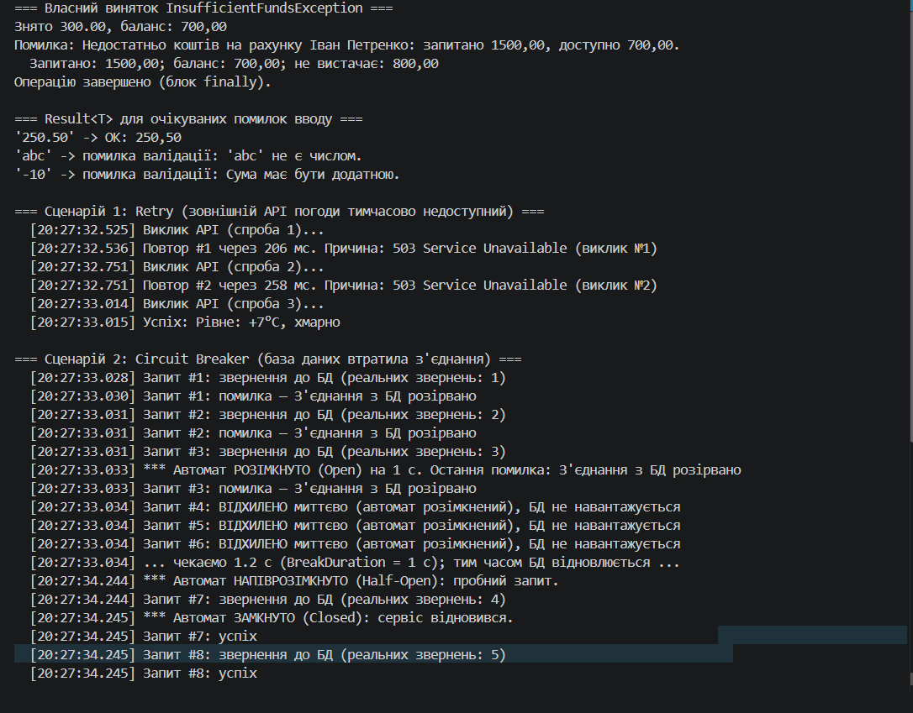
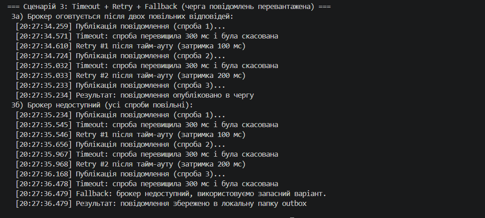

# Самостійна робота №19 (ООП)

**Тема:** Дизайн винятків і політики retry: теорія та кейси Polly
**Проєкт:** `IndependentWork19`
**Звіт (сценарії, обґрунтування, висновки):** [REPORT.md](REPORT.md)

## Що реалізовано

| Частина | Файл | Опис |
|---|---|---|
| Власний виняток | `InsufficientFundsException.cs` | три стандартні конструктори + четвертий із `RequestedAmount`/`CurrentBalance`; обчислювана властивість `Shortfall` |
| Предметна область | `BankAccount.cs` | `Withdraw` кидає виняток; `ParseAmount` повертає `Result<decimal>` |
| `Result<T>` | `Result.cs` | мінімальний тип для очікуваних невдач |
| Сценарії Polly | `ResilienceScenarios.cs` | три різні сценарії на `ResiliencePipelineBuilder` |
| Демонстрація | `Program.cs` | виклик усього з `Main` |

### Сценарії Polly

| № | Проблема | Стратегія Polly |
|---|---|---|
| 1 | Зовнішній API погоди тимчасово повертає 503 | **Retry** + експоненційна затримка + jitter |
| 2 | База даних втратила з'єднання надовго | **Circuit Breaker** (Closed → Open → Half-Open → Closed) |
| 3 | Брокер повідомлень перевантажений і відповідає повільно | **Timeout + Retry + Fallback** (комбінація) |

Кожна спроба й подія стратегії логуються з часовою міткою.

## Структура

```text
IndependentWork19/
├── IndependentWork19.csproj      # NuGet: Polly 8.5.0
├── InsufficientFundsException.cs
├── Result.cs
├── BankAccount.cs
├── ResilienceScenarios.cs
├── Program.cs
├── README.md
├── REPORT.md
└── docs/                         # сюди — скриншот запуску
```
### Скриншот запуску
dotnet run(
   
   
)
## Відповіді на контрольні запитання

1. **Виняток чи `Result`?**
   Виняток — для справді виняткових ситуацій, коли метод не може виконати контракт (з'єднання з БД розірвано, недостатньо коштів). `Result` — для очікуваних невдач, які є звичайною частиною логіки (валідація вводу: `'abc'` не є числом).
2. **Три стандартні конструктори власного винятку?**
   Без параметрів, з `message`, з `message` та `innerException`.
3. **Circuit Breaker vs Retry?**
   Retry повторює спробу після тимчасового збою. Circuit Breaker після серії невдач **припиняє звертатися** до сервісу на певний час, давши йому відновитися, і швидко відхиляє запити. Retry доречний при короткочасних збоях, Circuit Breaker — коли сервіс «лежить» надовго.
4. **Для чого Bulkhead?**
   Обмежує кількість одночасних викликів/ресурсів для окремої операції (наприклад, до 10 запитів до зовнішнього API), щоб збій чи повільність однієї залежності не вичерпали ресурси всього застосунку.
5. **Чому важливий jitter?**
   Без випадкової складової всі клієнти повторюють запит одночасно й знову перевантажують сервіс (thundering herd). Jitter розводить повтори в часі.
6. **Ризики Retry для неідемпотентної операції?**
   Повторне виконання може продублювати дію (подвійне списання, дубль замовлення), якщо першу спробу було виконано, але відповідь загубилася. Потрібні ключі ідемпотентності або заборона повторів.
