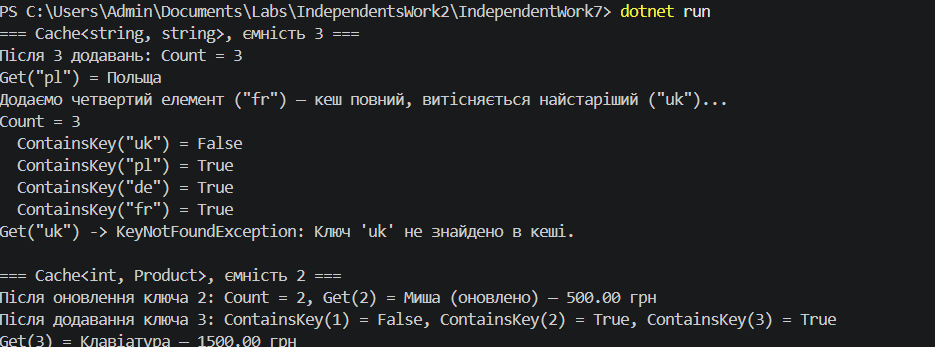
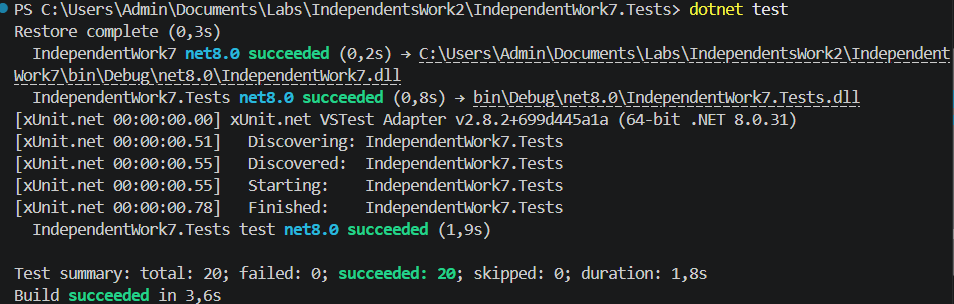

# Самостійна робота №13 (ООП)

**Тема:** Узагальнений кеш `Cache<TKey, TValue>` із тестами
**Проєкти:** `IndependentWork7` (кеш + демонстрація) та `IndependentWork7.Tests` (xUnit)

## Мета

Розробити узагальнений кеш обмеженої ємності з політикою витіснення **FIFO** (First In, First Out) і покрити його юніт-тестами.

## Що реалізовано

Клас `Cache<TKey, TValue>` (`where TKey : notnull`):

| Елемент | Опис |
|---|---|
| `_capacity` (`int`) | максимальна кількість елементів |
| `_cache` (`Dictionary<TKey, TValue>`) | сховище пар ключ-значення |
| `_keysOrder` (`Queue<TKey>`) | порядок додавання ключів (для FIFO) |
| `Cache(int capacity)` | конструктор; для `capacity <= 0` викидає `ArgumentOutOfRangeException` |
| `void Add(TKey key, TValue value)` | додає елемент; якщо кеш повний — спершу видаляє найстаріший |
| `TValue Get(TKey key)` | повертає значення (через `TryGetValue`); якщо ключа немає — `KeyNotFoundException` |
| `bool ContainsKey(TKey key)` | перевіряє наявність ключа |
| `int Count` | поточна кількість елементів |

Рішення, які варто знати:

- **Оновлення наявного ключа** лише змінює значення: нічого не витісняється, і порядок FIFO не змінюється.
- **`Get` не впливає на порядок витіснення** (це FIFO, а не LRU) — для цього є окремий тест.
- Усі публічні методи відхиляють `null`-ключ (`ArgumentNullException`).

## Структура

```text
SelfStudy-Theme2/
├── IndependentWork7/
│   ├── IndependentWork7.csproj
│   ├── Cache.cs
│   ├── Product.cs
│   ├── Program.cs
│   ├── README.md
│   └── docs/                      # сюди — скриншот запуску
└── IndependentWork7.Tests/
    ├── IndependentWork7.Tests.csproj   # посилання на IndependentWork7
    └── CacheTests.cs                   # 20 тестів
```


## Тести (`IndependentWork7.Tests`)

Усього 20 тестів (xUnit, у т.ч. параметризовані). Вони покривають:

| Що перевіряється | Приклади тестів |
|---|---|
| Конструктор | `Constructor_NonPositiveCapacity_Throws` (0 та від'ємна ємність) |
| Додавання | `Add_NewItem_IsStored`, `Add_MultipleItemsWithinCapacity_KeepsAll`, оновлення наявного ключа, `null`-ключ |
| Отримання | `Get_ExistingKey_ReturnsValue`, `Get_MissingKey_ThrowsKeyNotFoundException` |
| Переповнення (FIFO) | `Add_WhenFull_EvictsOldestItem`, `Add_ManyItems_EvictsInInsertionOrder`, `Get_DoesNotAffectEvictionOrder_FifoNotLru` |
| `ContainsKey` | наявний ключ, відсутній ключ, ключ після витіснення |
| `Count` | порожній кеш, зростання, ніколи не перевищує ємність |

## Демонстрація (`Main`)

Показано `Cache<string, string>` і `Cache<int, Product>`: додавання, отримання, переповнення кешу та витіснення найстарішого елемента.

### Скриншот запуску

dotnet run (
   
)

dotnet test(
   
)
## Відповіді на контрольні запитання

1. **Переваги `Cache<TKey, TValue>` порівняно з окремими неузагальненими реалізаціями?**
   Один код для будь-яких типів ключа і значення, перевірка типів на етапі компіляції, без приведення типів і боксингу.
2. **Чому для FIFO зручно поєднувати `Dictionary` з `Queue` (або `LinkedList`)?**
   `Dictionary` дає пошук за ключем за O(1), а `Queue` зберігає порядок додавання: найстаріший ключ завжди на початку, і `Dequeue` теж O(1). `LinkedList` дозволяє ще й переміщати елемент у кінець, що потрібно для LRU.
3. **Коли `Get` має кидати `KeyNotFoundException`, а коли краще `TryGetValue`-підхід?**
   Виняток доречний, коли відсутність ключа означає помилку в логіці (ключ мав би бути). Для кешу, де «промах» є звичайною ситуацією, зручніший `TryGet`: він не створює винятків і швидший.
4. **Які тести критично важливі для політики витіснення?**
   Що витісняється саме найстаріший елемент, що порядок витіснення відповідає порядку додавання, що оновлення наявного ключа не змінює порядок, що читання не «омолоджує» елемент (FIFO), і що `Count` ніколи не перевищує ємність.
