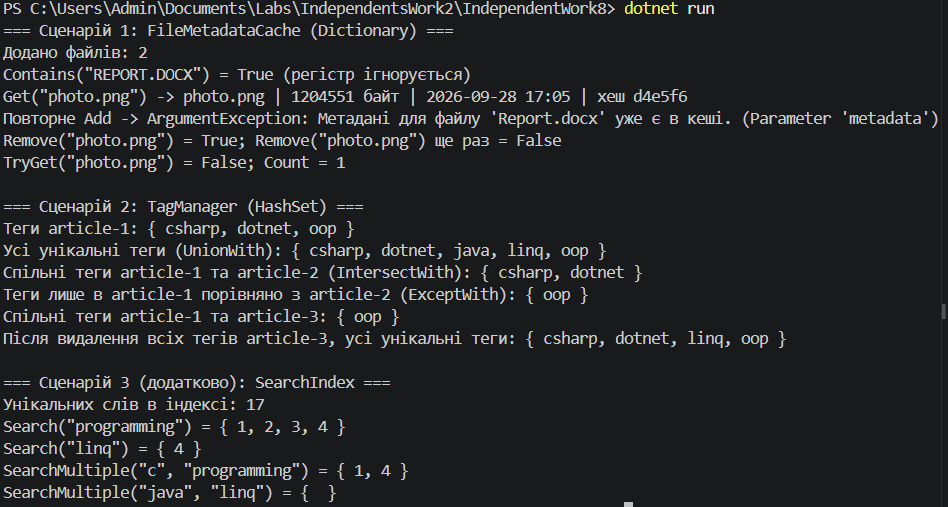

# Самостійна робота №14 (ООП)

**Тема:** Вивчення `Dictionary<TKey, TValue>` та `HashSet<T>` у бібліотеках .NET
**Проєкт:** `IndependentWork8`
**Звіт з аналізом open-source, таблицею складності та висновками:** [REPORT.md](REPORT.md)

## Що реалізовано

| Сценарій | Клас | Колекції | Статус |
|---|---|---|---|
| 1. Кеш метаданих файлів | `FileMetadataCache`, `FileMetadata` | `Dictionary<string, FileMetadata>` | обов'язковий |
| 2. Унікальні теги | `TagManager` | `Dictionary<string, HashSet<string>>` + `UnionWith`, `IntersectWith`, `ExceptWith` | обов'язковий |
| 3. Пошуковий індекс | `SearchIndex` | `Dictionary<string, HashSet<int>>` | додатковий |

Особливості:

- `FileMetadataCache` використовує `StringComparer.OrdinalIgnoreCase` (імена файлів без урахування регістру); `Add` кидає виняток для дубліката, `Get` — `KeyNotFoundException`, є й безвинятковий `TryGet`.
- `TagManager` порівнює теги без урахування регістру (`csharp` і `CSharp` — один тег) і повертає **копії** множин, щоб зовнішній код не зіпсував внутрішній стан.
- `SearchIndex.SearchMultiple` виконує AND-пошук перетином множин документів.

## Структура

```text
IndependentWork8/
├── IndependentWork8.csproj
├── FileMetadata.cs
├── FileMetadataCache.cs
├── TagManager.cs
├── SearchIndex.cs
├── Program.cs
├── README.md
├── REPORT.md
└── docs/           
```
### Скриншот запуску

dotnet run(
   
)

## Відповіді на контрольні запитання

1. **Переваги generic-колекцій над неузагальненими?**
   Типобезпека на етапі компіляції, відсутність боксингу для типів значень (швидше й економніше за `Hashtable`/`ArrayList`), не потрібні приведення типів.
2. **Коли `Dictionary`, а коли `HashSet`?**
   `Dictionary` — коли потрібно за ключем швидко знайти пов'язане значення (кеш, довідник). `HashSet` — коли важлива лише наявність елемента й унікальність (теги, відвідані вузли, видалення дублікатів) або множинні операції.
3. **Як `IEqualityComparer<T>` впливає на коректність і продуктивність?**
   Він визначає, які об'єкти вважаються рівними (`OrdinalIgnoreCase`, порівняння лише за іменем). Узгоджені `Equals`/`GetHashCode` — обов'язкова умова коректності. Поганий `GetHashCode` (багато колізій) перетворює O(1) на O(n).
4. **Чому інвертований індекс зручно будувати на `Dictionary<string, HashSet<int>>`?**
   Словник дає миттєвий перехід від слова до множини документів, а `HashSet<int>` не допускає дублікатів і дозволяє об'єднувати/перетинати результати (OR/AND-пошук) без ручного коду.
