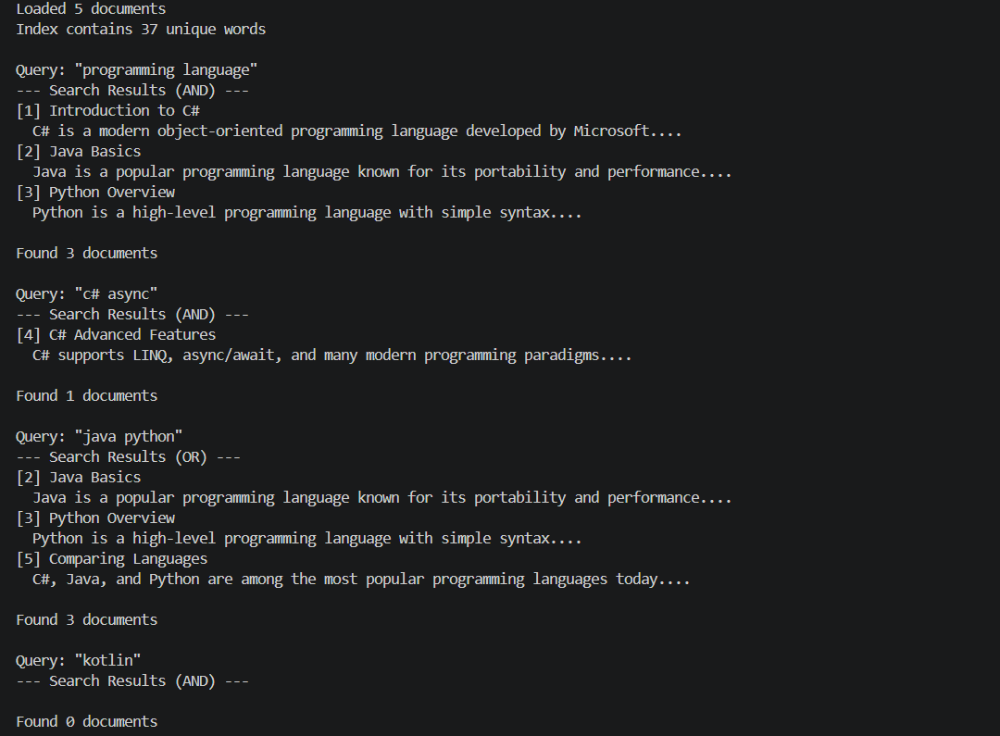
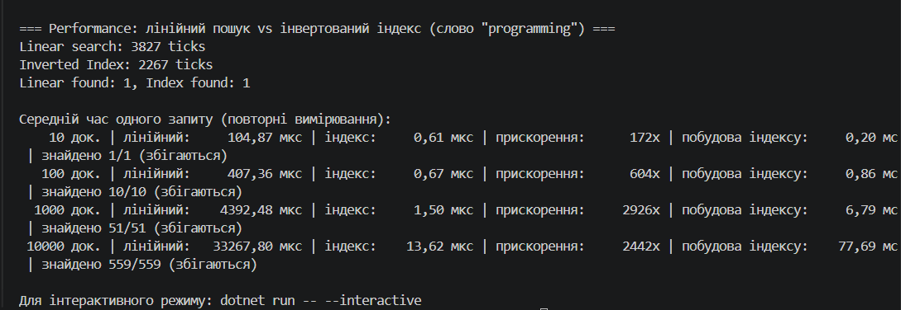

# Самостійна робота №16 (ООП)

**Тема:** Колекції в практиці ООП: інвертований індекс і вимірювання продуктивності
**Проєкт:** `InvertedIndexDemo`
**Звіт (реалізація, таблиця вимірювань, висновки):** [REPORT.md](REPORT.md)

## Що реалізовано

| Клас | Призначення |
|---|---|
| `Document` | документ (`Id`, `Title`, `Content`) |
| `TextProcessor` | `Tokenize` (регістр + пунктуація через `\w+`) та `RemoveStopWords` |
| `InvertedIndex` | `Dictionary<string, HashSet<int>>` + `Dictionary<int, Document>`; `AddDocument`, `SearchSingleWord`, `SearchMultipleWords` (AND, `IntersectWith`), `SearchAnyWord` (OR, `UnionWith`), `DocumentCount`, `UniqueWords` |
| `PerformanceTest` | порівняння лінійного пошуку та індексу на 10 / 100 / 1000 / 10000 документів |

Особливості:

- Обидва підходи до пошуку використовують **однакову нормалізацію** (`TextProcessor.Tokenize`), тому порівняння коректне; кількості знайдених документів перевіряються на збіг.
- `\w+` не вважає `#` літерою, тому `C#` перетворюється на `c`. Запити токенізуються так само, тому `c# async` знаходить документ 4.
- Пошуки AND/OR працюють з **копіями** множин, тож внутрішній індекс не псується.
- Дані для вимірювань генеруються з фіксованим `Seed = 42`.

## Структура

```text
InvertedIndexDemo/
├── InvertedIndexDemo.csproj
├── Document.cs
├── TextProcessor.cs
├── InvertedIndex.cs
├── PerformanceTest.cs
├── Program.cs
├── README.md
├── REPORT.md
└── docs/            # сюди — скриншот запуску
```
### Скриншот запуску
dotnet run(
  
  
)
## Відповіді на контрольні запитання

1. **Чому `Dictionary<string, HashSet<int>>` добре підходить для інвертованого індексу?**
   Словник дає перехід від слова до документів за O(1), а `HashSet<int>` не допускає дублікатів ідентифікаторів і дозволяє швидко виконувати операції над множинами.
2. **Які переваги `HashSet<T>` в AND/OR-пошуку?**
   AND — це перетин (`IntersectWith`), OR — об'єднання (`UnionWith`). Вони вбудовані й працюють ефективно, без вкладених циклів.
3. **Чому при вимірюванні важлива однакова нормалізація?**
   Якщо лінійний пошук і індекс по-різному обробляють регістр і пунктуацію, вони знайдуть різні документи, і порівняння часу втрачає сенс, бо порівнюються неоднакові задачі.
4. **Які обмеження простого індексу без ранжування, стемінгу й фраз?**
   Немає впорядкування за релевантністю; «language» і «languages» — різні слова; не можна шукати точну фразу; індекс не оновлюється при видаленні чи зміні документа й займає додаткову пам'ять.
