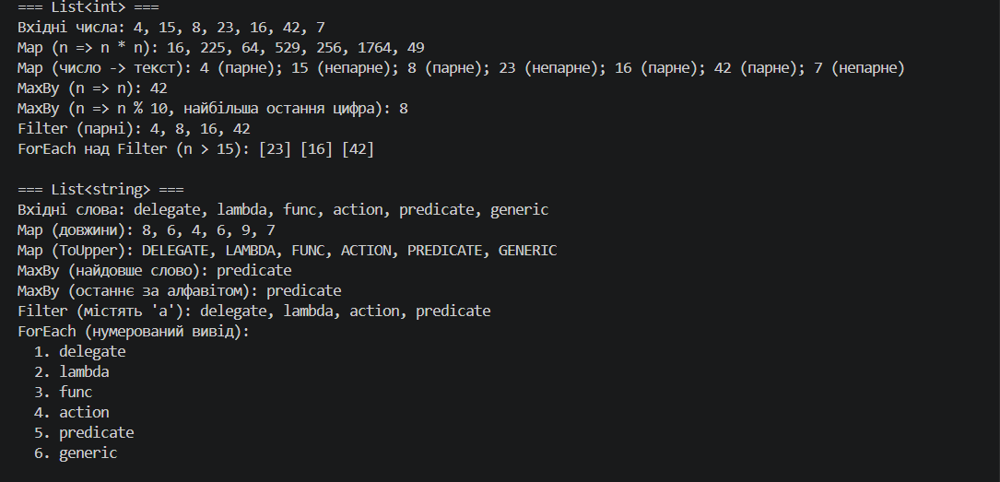
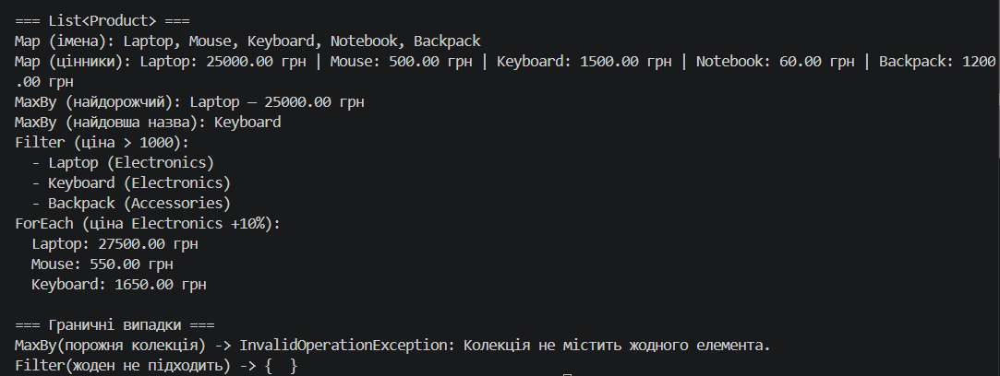

# Самостійна робота №15 (ООП)

**Тема:** Делегати й лямбда-вирази: власні утиліти для колекцій
**Проєкт:** `lab9-self-v14` (варіант 14)

## Мета

Закріпити делегати та лямбда-вирази через створення власних узагальнених методів-утиліт для роботи з колекціями.

## Що реалізовано

Статичний клас `CollectionUtils` з чотирма узагальненими методами (без використання LINQ-операторів у реалізації):

| Метод | Делегат | Призначення | Аналог LINQ |
|---|---|---|---|
| `Map<TSource, TResult>` | `Func<TSource, TResult>` | перетворює кожен елемент | `Select` |
| `MaxBy<T, TKey>` (`where TKey : IComparable<TKey>`) | `Func<T, TKey>` | елемент з максимальним ключем | `MaxBy` |
| `Filter<T>` | `Predicate<T>` | елементи, що задовольняють умову | `Where` |
| `ForEach<T>` | `Action<T>` | виконує дію для кожного елемента | — (є `List<T>.ForEach`) |

Рішення, які варто знати:

- `Map` і `Filter` реалізовано **лінивими** (через `yield return`), а перевірку аргументів виконано одразу під час виклику.
- `MaxBy` для **порожньої колекції викидає `InvalidOperationException`**, а не повертає `default(T)`: інакше «немає елементів» неможливо відрізнити від справжнього результату. Якщо максимум мають кілька елементів, повертається перший.
- Усі методи перевіряють аргументи на `null`.

## Структура

```text
lab9-self-v14/
├── lab9-self-v14.csproj
├── CollectionUtils.cs   # власні утиліти
├── Product.cs           # клас для демонстрації
├── Program.cs           # демонстрація на трьох колекціях
├── README.md
└── docs/                # сюди — скриншот запуску
```
### Скриншот запуску
dotnet run(
   
   
)
## Звіт

### Чому делегати корисні для створення таких утиліт?

Делегат дозволяє передати в метод **поведінку** як параметр. Алгоритм обходу колекції (цикл, перевірка, накопичення) написано один раз, а що саме робити з елементом (перетворити, перевірити, порівняти), вирішує викликач. Без делегатів довелося б писати окремий метод під кожне перетворення (`GetNames`, `GetPrices`, `FilterExpensive`, ...).

### Як лямбда-вирази спрощують виклик цих методів?

Лямбда описує невелику функцію прямо на місці виклику, без окремого іменованого методу: `CollectionUtils.Filter(products, p => p.Price > 1000m)`. Типи параметрів виводяться з типу колекції, код стає коротшим, а умова лежить поруч із викликом. Лямбда також може захоплювати локальні змінні (див. лічильник `index` у `ForEach`).

### Порівняння з вбудованими LINQ-операторами

| Аспект | Власні методи | LINQ |
|---|---|---|
| Синтаксис | статичні виклики `CollectionUtils.Map(x, ...)` | extension-методи: `x.Select(...)`, можна будувати ланцюжки |
| Ліниве виконання | `Map`, `Filter` — так, `ForEach` і `MaxBy` — ні | майже всі операції — так |
| Порожня колекція в `MaxBy` | `InvalidOperationException` | залежить від типу: для типів значень викидає виняток, для посилальних може повернути `null` |
| Оптимізації | немає | вбудовані: швидкі шляхи для `List<T>`/масивів, `Count` без перебору тощо |
| Кількість операцій | чотири | сотні (`GroupBy`, `Join`, `OrderBy`, ...) |
| Користь | розуміння механізму делегатів і generics | промислове використання |

**Висновок:** власні утиліти показують, як працюють `Select`/`Where`/`MaxBy` «під капотом». У реальному коді варто користуватись LINQ, бо він протестований, оптимізований і добре читається. Власні реалізації виправдані для навчання, для специфічної поведінки (наприклад, інша семантика порожньої колекції) або там, де LINQ недоступний.

## Відповіді на контрольні запитання

1. **Чому делегати зручні для передавання поведінки в узагальнені методи?**
   Вони типізовані, їх можна передавати як звичайні значення, а generic-параметри дозволяють описати сигнатуру функції для будь-яких типів.
2. **Різниця між `Func<T, TResult>`, `Action<T>` та `Predicate<T>`?**
   `Func` повертає значення типу `TResult`, `Action` нічого не повертає (`void`), `Predicate<T>` повертає `bool` і є аналогом `Func<T, bool>`.
3. **Переваги поєднання generic-методів і лямбда-виразів?**
   Один метод працює з будь-яким типом елементів із перевіркою типів на етапі компіляції, а поведінка передається лаконічно, без допоміжних класів чи методів.
4. **Коли власні `Map`/`Filter` варто писати самостійно, навіть якщо є LINQ?**
   Для навчання, для нестандартної семантики, у середовищах без LINQ (обмежені платформи) та коли потрібна особлива поведінка (наприклад, логування чи інший виняток для порожньої колекції).
