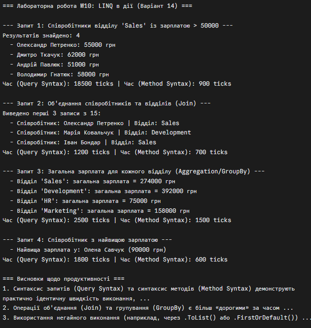

# Лабораторна робота №10 · Варіант 14

**Дисципліна:** Об'єктно-орієнтоване програмування  
**Тема:** `HashSet<T>`, `Queue<T>`, `Stack<T>`: практичні сценарії  
**Варіант 14:** система резервного копіювання

## Мета

Навчитися ефективно використовувати LINQ для фільтрації, об’єднання (join) та агрегації даних,
а також аналізувати продуктивність LINQ-запитів.

## Структура проєкту

```text
lab10v14/
├── lab10v14.csproj
├── Program.cs          // демонстрація в Main
```

## Знімок екрану

- Приклад запуску: 

## Контрольні запитання

**1. Поясніть різницю між синтаксисом запитів та синтаксисом методів у LINQ. Коли який краще використовувати??**  
Синтаксис запитів (`Query Syntax`) нагадує SQL-подібні конструкції (`from`, `where`, `select`, `join`, `orderby`) і є дуже читабельним для складних зв'язків чи групувань.

Синтаксис методів (`Method` `Syntax`) використовує лямбда-вирази та методи розширення (`Where`, `Select`, `Join`, `GroupBy`). Він є більш універсальним, оскільки деякі просунуті оператори `LINQ` (наприклад, `Average`, `Skip`, `Take`) не мають прямого ключового слова в синтаксисі запитів. На практиці синтаксис методів використовується частіше.

**2. Для чого використовуються операції Join та GroupJoin? У чому їхня відмінність?**  
`Join` виконує внутрішнє об'єднання (`Inner Join`) двох колекцій на основі збігу ключів, повертаючи плоску послідовність пар «елемент 1 — елемент 2».

GroupJoin виконує об'єднання з групуванням (аналог `Left` `Outer` `Join`), де кожен елемент першої колекції зіставляється з колекцією пов'язаних елементів із другої колекції.

**3. Наведіть приклади агрегуючих операцій LINQ та поясниіть їхнє призначення**  
`Sum` — обчислює суму числових значень.
`Average` — знаходить середнє арифметичне.
`Count` — підраховує кількість елементів, що задовольняють умову.
`Min / Max` — визначають найменше або найбільше значення в послідовності.
`Aggregate` — виконує довільну акумулюючу функцію над елементами.

**4. Як можна виміряти продуктивність LINQ-запитів? Які фактори впливають на неї?**  
Продуктивність вимірюється за допомогою класу `System.Diagnostics.Stopwatch` (вимірювання часу у мілісекундах або тактах процесора `ticks`).

На продуктивність впливають: обсяг даних (розмір колекцій), наявність складних з'єднань (`Join`, `GroupBy`), часте використання негайного виконання `(ToList(), Count())` та складність умов фільтрації.
