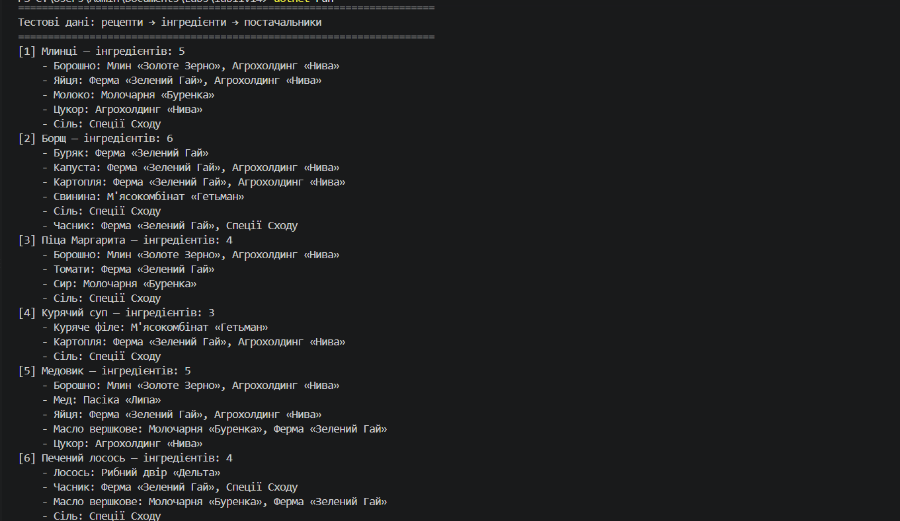
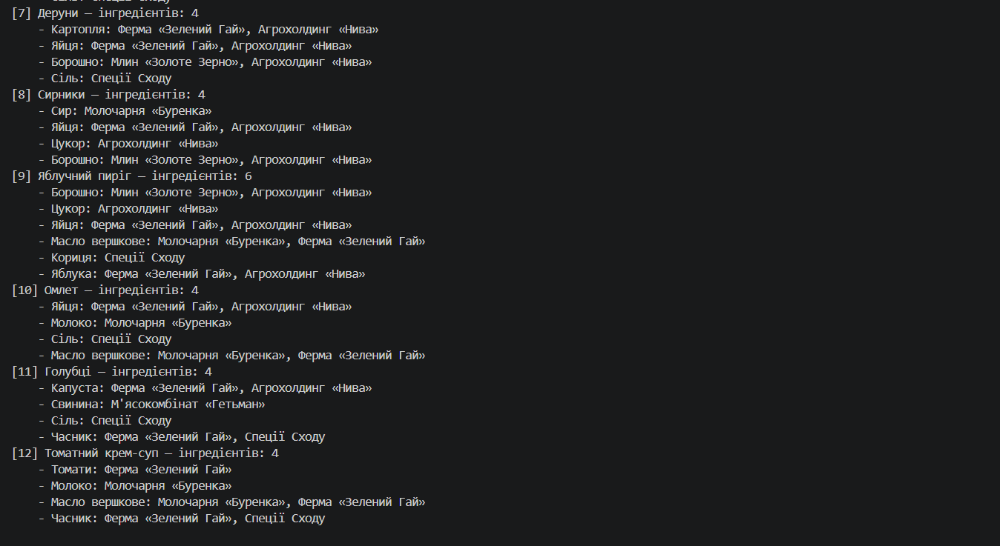
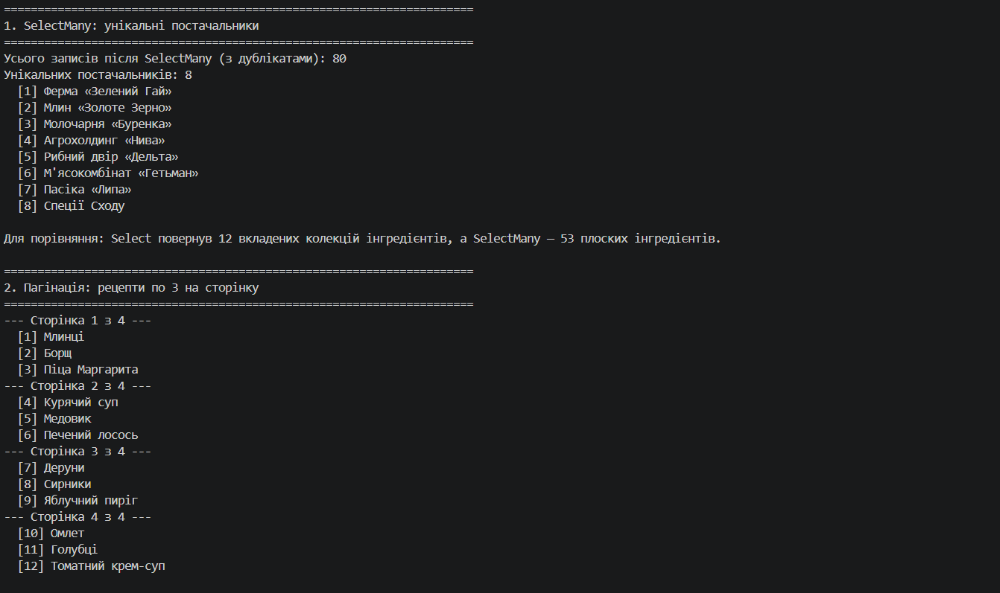
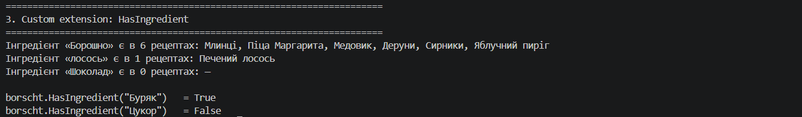

# Лабораторна робота №11 — LINQ: SelectMany, пагінація й custom extensions

**Дисципліна:** Об'єктно-орієнтоване програмування (ІПЗ-3/2)
**Варіант:** 14 — Рецепти та їхні інгредієнти з постачальниками


## Мета

Навчитися використовувати `SelectMany` для вкладених колекцій, реалізовувати пагінацію через `Skip`/`Take` та створювати власні методи розширення.

## Завдання варіанта 14

| № | Вимога | Реалізація |
|---|--------|-----------|
| 1 | `SelectMany`: усі унікальні постачальники з усіх інгредієнтів усіх рецептів | `Program.cs`, розділ 1 |
| 2 | Пагінація: рецепти по 3 на сторінку | `PagingExtensions.GetPage` + `Program.cs`, розділ 2 |
| 3 | Custom extension: `HasIngredient(string ingredientName)` для `Recipe` | `Extensions/RecipeExtensions.cs` |


## Класи сутностей

- **`Recipe`** — `Id`, `Name`, `List<Ingredient> Ingredients`
- **`Ingredient`** — `Id`, `Name`, `List<Supplier> Suppliers`
- **`Supplier`** — `Id`, `Name`

## Тестові дані

12 рецептів (Млинці, Борщ, Піца Маргарита, Курячий суп, Медовик, Печений лосось, Деруни, Сирники, Яблучний пиріг, Омлет, Голубці, Томатний крем-суп), 18 інгредієнтів і 8 постачальників. Інгредієнти та постачальники повторюються між рецептами, а в деяких інгредієнтів є по кілька постачальників — тому унікалізація результату `SelectMany` має сенс.

## Ключові фрагменти коду

### 1. SelectMany

```csharp
var allSuppliers = recipes
    .SelectMany(r => r.Ingredients)
    .SelectMany(i => i.Suppliers)
    .ToList();

var uniqueSuppliers = allSuppliers
    .DistinctBy(s => s.Id)
    .OrderBy(s => s.Id)
    .ToList();
```

### 2. Пагінація

```csharp
public static IEnumerable<T> GetPage<T>(this IEnumerable<T> source, int pageNumber, int pageSize)
    => source.Skip((pageNumber - 1) * pageSize).Take(pageSize);
```

### 3. Власний метод розширення

```csharp
public static bool HasIngredient(this Recipe recipe, string ingredientName)
    => recipe.Ingredients.Any(i =>
        string.Equals(i.Name, ingredientName.Trim(), StringComparison.OrdinalIgnoreCase));
```


## Приклад запуску





## Відповіді на контрольні питання

**1. Для чого використовується `SelectMany`? У чому відмінність від `Select`?**
`SelectMany` проєктує кожен елемент у колекцію і «розгортає» (flatten) усі ці колекції в одну плоску послідовність. `Select` повертає рівно один результат на кожен вхідний елемент, тому для вкладених колекцій дасть колекцію колекцій. Приклад із проєкту: `recipes.Select(r => r.Ingredients)` повертає 12 списків інгредієнтів (`IEnumerable<List<Ingredient>>`), а `recipes.SelectMany(r => r.Ingredients)` — один плоский список усіх інгредієнтів (`IEnumerable<Ingredient>`).

**2. Як реалізувати пагінацію через LINQ?**
За допомогою `Skip` і `Take`: `Skip((page - 1) * pageSize)` пропускає елементи попередніх сторінок, а `Take(pageSize)` бере елементи поточної. Кількість сторінок: `(int)Math.Ceiling(count / (double)pageSize)`. Для стабільної пагінації колекція має мати визначений порядок (за потреби — `OrderBy` перед `Skip`).

**3. Що таке методи розширення і як вони інтегруються з LINQ?**
Методи розширення — статичні методи у статичному класі, перший параметр яких позначено `this`; вони викликаються як методи екземпляра, хоча вихідний код типу не змінюється. Сам LINQ — це набір методів розширення для `IEnumerable<T>` (клас `Enumerable`, простір імен `System.Linq`), тому власні методи розширення вільно вбудовуються в ланцюжки запитів: `recipes.Where(r => r.HasIngredient("Мед")).GetPage(1, 3)`.

**4. Приклад власного методу розширення для `IEnumerable<T>`.**
`GetPage<T>` у `PagingExtensions` повертає задану сторінку будь-якої колекції:

```csharp
public static IEnumerable<T> GetPage<T>(this IEnumerable<T> source, int pageNumber, int pageSize)
    => source.Skip((pageNumber - 1) * pageSize).Take(pageSize);
```

Він інкапсулює типову логіку пагінації й не прив'язаний до конкретної сутності. Метод `HasIngredient` для `Recipe` — приклад розширення доменної сутності з бізнес-логікою варіанту.
