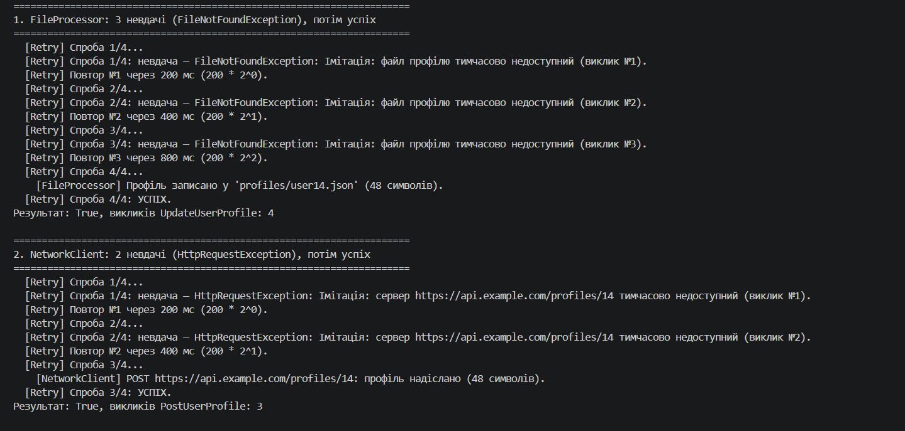
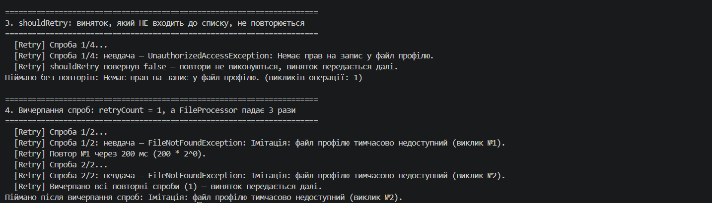

# Лабораторна робота №12 — Обробка IO/мережевих помилок та патерн Retry

**Дисципліна:** Об'єктно-орієнтоване програмування (ІПЗ-3/2)
**Студент:** Левчук Роман
**Варіант:** 14 — Оновлення профілю користувача
**Проєкт:** `OOP-Levchuk/lab18v14`

## Завдання варіанта 14

| Клас | Метод | Імітація помилки | Після цього |
|------|-------|------------------|-------------|
| `FileProcessor` | `void UpdateUserProfile(string path, string profileJson)` | `FileNotFoundException` перші **3** рази | успіх |
| `NetworkClient` | `bool PostUserProfile(string url, string profileJson)` | `HttpRequestException` перші **2** рази | успіх (`true`) |

`shouldRetry`: повторювати для `FileNotFoundException` та `HttpRequestException`.

## Структура проєкту

```
lab18v14/
├── lab18v14.csproj
├── Program.cs                  # 4 демонстраційні сценарії
├── Helpers/
│   └── RetryHelper.cs          # ExecuteWithRetry<T> з експоненційною затримкою та логуванням
├── Services/
│   ├── FileProcessor.cs
│   └── NetworkClient.cs
└── docs/
    └── screenshot.png          # <- сюди додати скріншот запуску
```

## RetryHelper

```csharp
public static T ExecuteWithRetry<T>(
    Func<T> operation,
    int retryCount = 3,
    TimeSpan initialDelay = default,
    Func<Exception, bool>? shouldRetry = null)
```

- `retryCount` — кількість **повторних** спроб (усього спроб = `retryCount + 1`).
- Затримка перед повтором №n (n = 0, 1, 2, …): `initialDelay * 2^n`.
- Кожна спроба та причина невдачі логуються в консоль.
- Якщо `shouldRetry` повертає `false`, виняток одразу передається далі; після вичерпання спроб виняток також передається далі (`throw;` зберігає стек).

## Сценарії в Main

1. `FileProcessor`: 3 невдачі → успіх на 4-й спробі (затримки 200, 400, 800 мс).
2. `NetworkClient`: 2 невдачі → успіх на 3-й спробі (затримки 200, 400 мс).
3. `shouldRetry` у дії: `UnauthorizedAccessException` не входить до списку — жодних повторів.
4. Вичерпання спроб: `retryCount = 1`, а операція падає 3 рази — виняток піднімається назовні.

## Приклад запуску




## Висновок

Експоненційна затримка подвоює час очікування після кожної невдачі: при `initialDelay = 200 мс` для `FileProcessor` (3 повтори) пауза становить 200 → 400 → 800 мс (разом 1400 мс), а для `NetworkClient` (2 повтори) — 200 → 400 мс. Так тимчасові збої встигають усунутися, а сервер чи файлова система не засипаються частими запитами. Делегат `shouldRetry` обмежує повтори лише винятками з варіанту, тому постійні помилки (наприклад, `UnauthorizedAccessException`) не повторюються марно.

## Відповіді на контрольні запитання

**1. Які винятки найчастіше виникають при роботі з файлами та мережею?**
Файли: `FileNotFoundException`, `DirectoryNotFoundException`, `IOException`, `UnauthorizedAccessException`. Мережа: `HttpRequestException`, `SocketException`, `TaskCanceledException`/`TimeoutException`.

**2. Принцип роботи Retry. Коли доцільно використовувати?**
Операція, що завершилась помилкою, виконується повторно задану кількість разів із паузами між спробами. Доцільно для *тимчасових* (transient) збоїв: недоступність мережі чи сервера, блокування файлу іншим процесом. Не варто повторювати постійні помилки (невірні дані, відсутність прав) та небезпечно повторювати неідемпотентні операції.

**3. Як реалізувати експоненційну затримку?**
Затримка перед n-м повтором: `initialDelay * 2^n`, у коді — `TimeSpan.FromTicks(initialDelay.Ticks * (1L << attempt))`. Додатково на практиці додають джитер (випадкову добавку) та верхню межу затримки.

**4. Для чого потрібен `shouldRetry`?**
Це делегат-фільтр: він вирішує за типом (або властивостями) винятку, чи варто повторювати спробу. Завдяки йому `RetryHelper` залишається універсальним, а правила повторів задає викликаючий код; для нетимчасових помилок виняток передається далі одразу.
