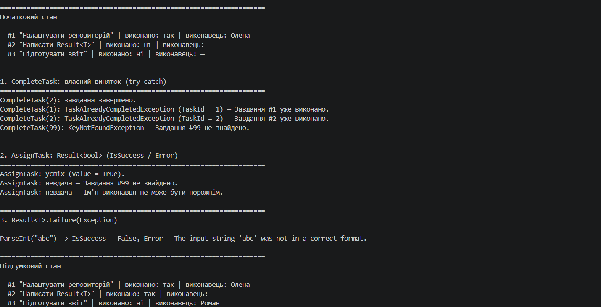

# Лабораторна робота №13 — Власні винятки та патерн Result

**Дисципліна:** Об'єктно-орієнтоване програмування (ІПЗ-3/2)
**Студент:** Левчук Роман
**Варіант:** 14 — Управління задачами
**Проєкт:** `OOP-Levchuk/lab19v14`

## Завдання варіанта 14

- **Власний виняток:** `TaskAlreadyCompletedException (int TaskId)`
- **Service:** `TaskService`
  - `void CompleteTask(int taskId)` — кидає `TaskAlreadyCompletedException`, якщо завдання вже виконано;
  - `Result<bool> AssignTask(int taskId, string assignee)` — `Result.Success` або `Result.Failure` (якщо завдання не знайдено).

## Структура проєкту

```
lab19v14/
├── lab19v14.csproj
├── Program.cs                                  # демонстрація обох підходів
├── Exceptions/
│   └── TaskAlreadyCompletedException.cs        # власний виняток з властивістю TaskId
├── Common/
│   └── Result.cs                               # Result<T>: IsSuccess, Value, Error, Success/Failure
├── Models/
│   └── TaskItem.cs
├── Services/
│   └── TaskService.cs
└── docs/
    └── screenshot.png                          # <- сюди додати скріншот запуску
```

## Що реалізовано

- **`TaskAlreadyCompletedException`** — успадкований від `Exception`; стандартні конструктори (порожній, `message`, `message + innerException`), конструктори `int taskId`, конструктор для серіалізації та `GetObjectData`; властивість `TaskId`.
- **`Result<T>`** — поля `IsSuccess`, `Value`, `Error`; приватний конструктор `Result(T value, bool isSuccess, string error)`; фабричні методи `Success(T)`, `Failure(string)`, `Failure(Exception)`.
- **`TaskService`** — 2 методи за варіантом (`CompleteTask` — виняток, `AssignTask` — `Result<bool>`). Додатково `CompleteTask` кидає `KeyNotFoundException`, якщо завдання з таким Id не існує.

## Приклад запуску


## Висновок: виняток чи Result<T> у цьому варіанті

Метод `CompleteTask` кидає виняток, бо спроба завершити вже виконане завдання порушує інваріант предметної області й зазвичай означає помилку в логіці викликаючого коду; виняток із `TaskId` перериває виконання та несе контекст. Метод `AssignTask` повертає `Result<bool>`, бо «завдання не знайдено» чи порожнє ім'я виконавця — очікувані ситуації (наприклад, помилка введення користувача), які зручно обробити через `IsSuccess`/`Error` без витрат і складності `try-catch`.

## Відповіді на контрольні запитання

**1. Навіщо створювати власні типи винятків?**
Вони точно описують предметну помилку (`TaskAlreadyCompletedException` зрозуміліше за `InvalidOperationException`), дозволяють ловити конкретну помилку окремим `catch`, несуть додаткові дані (`TaskId`) і роблять код самодокументованим.

**2. Які стандартні конструктори рекомендується реалізувати?**
Порожній `()`, `(string message)`, `(string message, Exception innerException)` та, за потреби, захищений конструктор для серіалізації `(SerializationInfo, StreamingContext)`. Типи винятків зазвичай позначають `[Serializable]` і мають суфікс `Exception`.

**3. Що таке патерн Result? Коли він доцільніший за винятки?**
Метод повертає об'єкт, що містить або значення, або помилку (`IsSuccess`, `Value`, `Error`), замість викидання винятку. Доцільний для очікуваних і частих невдач — валідація вводу, пошук відсутнього елемента, бізнес-правила — коли виняток був би надто дорогим (збирання стеку) і ускладнював потік керування.

**4. Які сценарії краще обробляти винятками, а які — через Result?**
Винятки: непередбачувані або виняткові ситуації (збій з'єднання, пошкоджені дані, порушення інваріантів, помилки програміста), які не можна обробити на місці. Result: очікувані результати невдачі, що є частиною нормальної логіки (невалідні дані, «не знайдено», конфлікти). У варіанті 14: `CompleteTask` → виняток, `AssignTask` → `Result<bool>`.
