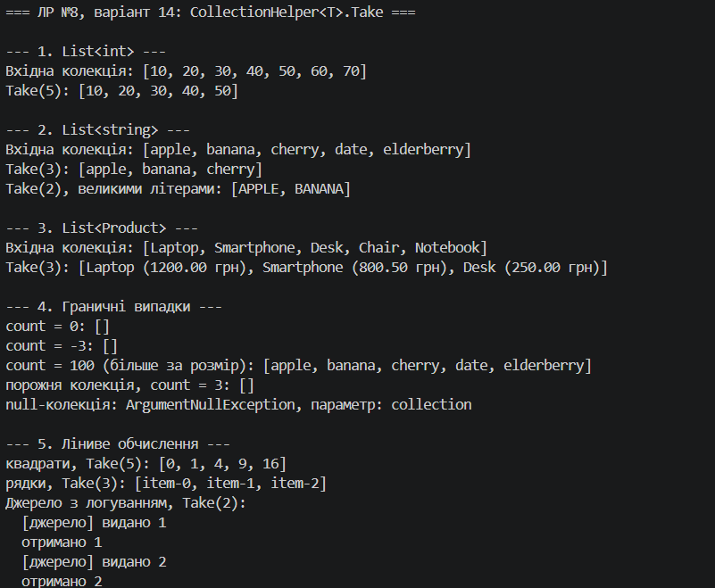

# Лабораторна робота №8 · Варіант 14

**Дисципліна:** Об'єктно-орієнтоване програмування  

## Мета

Навчитися передавати поведінку як параметр через делегати `Func`, `Action`, `Predicate`, будувати на цій основі універсальні операції над колекціями та використовувати лямбда-вирази в ООП.

## Завдання варіанту

Статичний узагальнений клас `CollectionHelper<T>` з методом:

```csharp
public static IEnumerable<T> Take(IEnumerable<T> collection, int count)
```

Метод повертає перші `count` елементів колекції. Власна реалізація: `Enumerable.Take` з LINQ **не використовується**.

## Реалізація

`Take` складається з двох частин:

1. **Відкрита обгортка** одразу перевіряє аргументи (`collection != null`), тому помилка виникає в момент виклику, а не при першому переборі.
2. **Приватний ітератор** (`yield return`) віддає елементи по одному й завершується відразу після `count`-го елемента. Наступний елемент у джерела не запитується.

Через це метод **лінивий** і працює навіть з нескінченними послідовностями.

### Граничні випадки

| Ситуація | Результат |
|---|---|
| `count == 0` | порожня послідовність |
| `count < 0` | порожня послідовність |
| `count` більше за розмір колекції | усі елементи колекції |
| порожня колекція | порожня послідовність |
| `collection == null` | `ArgumentNullException` (параметр `collection`) |
| нескінченна послідовність | коректно завершується після `count` елементів |

## Демонстрація в `Main`

Методи викликаються для `List<int>`, `List<string>`, `List<Product>` та нескінченних послідовностей. Лямбда-вирази використовуються:

- як **форматери** виводу (`Func<T, string>`): `p => $"{p.Name} ({p.Price:F2} грн)"`, `w => w.ToUpperInvariant()`;
- як **фабрики елементів** нескінченних послідовностей (`Func<int, T>`): `i => i * i`, `i => $"item-{i}"`.

## Знімок екрану

- Приклад запуску ()

## Контрольні запитання

**1. Що таке делегат і для чого він використовується?**  
Делегат — тип, що зберігає посилання на метод із певною сигнатурою. Він дозволяє передавати поведінку як параметр, зберігати її у змінній і викликати пізніше (зворотні виклики, події, узагальнені алгоритми).

**2. У чому різниця між `Func` та `Action`?**  
`Func<..., TResult>` приймає параметри й **повертає** значення, `Action<...>` приймає параметри, але нічого не повертає (`void`). `Predicate<T>` — окремий випадок: приймає `T` і повертає `bool`.

**3. Як лямбда-вирази спрощують роботу з делегатами?**  
Дозволяють записати метод прямо в місці передачі (`x => x * x`), без окремого іменованого методу. Код коротший, а компілятор сам виводить типи параметрів.

**4. Які переваги дають узагальнені методи при роботі з колекціями?**  
Один код працює з будь-яким типом елементів без дублювання та без приведення типів (`object`). Типобезпека перевіряється на етапі компіляції.

## Висновок

Реалізовано статичний клас `CollectionHelper<T>` з методом `Take` (варіант 14) на власній логіці з використанням `yield return`. Метод коректно обробляє граничні випадки та працює ліниво, що продемонстровано на `List<int>`, `List<string>`, `List<Product>` і нескінченних послідовностях із лямбда-виразами.
