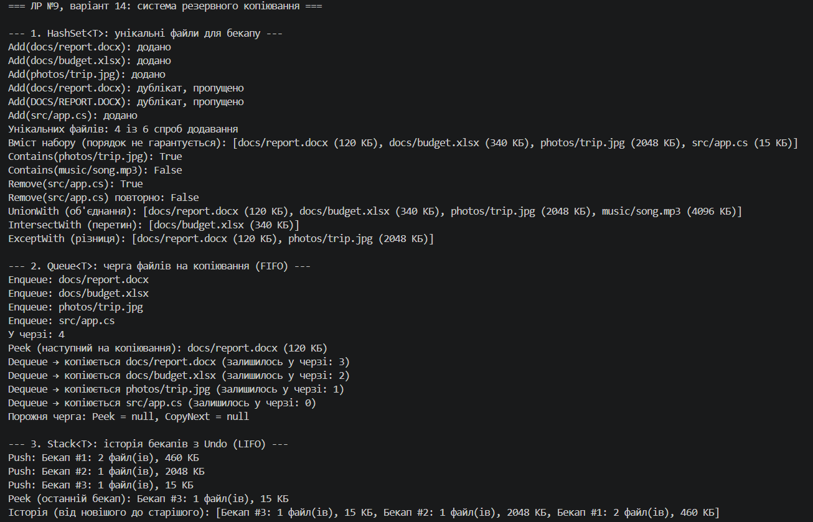

# Лабораторна робота №9 · Варіант 14

**Дисципліна:** Об'єктно-орієнтоване програмування  
**Тема:** `HashSet<T>`, `Queue<T>`, `Stack<T>`: практичні сценарії  
**Варіант 14:** система резервного копіювання

## Мета

Навчитися використовувати спеціалізовані колекції `HashSet<T>`, `Queue<T>`, `Stack<T>` для розв'язання практичних задач, зрозуміти їхні особливості та сценарії застосування.

## Завдання варіанту

| Колекція | Підзадача варіанту | Клас у проєкті |
|---|---|---|
| `HashSet<T>` | унікальні файли для бекапу | `BackupFileSet` |
| `Queue<T>` | черга файлів на копіювання | `CopyQueue` |
| `Stack<T>` | історія бекапів | `BackupHistory` |

Дані представляє клас `BackupFile` (шлях і розмір у КБ), а запис в історії — `BackupRecord`. Клас `BackupService` об'єднує всі три колекції в один сценарій.

## Структура проєкту

```text
lab9v14/
├── lab15v14.csproj
├── Program.cs          // демонстрація в Main
├── BackupFile.cs       // модель файлу, рівність за шляхом
├── BackupRecord.cs     // запис в історії бекапів
├── BackupFileSet.cs    // HashSet<T>
├── CopyQueue.cs        // Queue<T>
├── BackupHistory.cs    // Stack<T>
└── BackupService.cs    // зв'язує три колекції
```

## Реалізація

### HashSet: унікальні файли

`BackupFile` реалізує `IEquatable<BackupFile>`: два файли однакові, якщо збігаються шляхи **без урахування регістру**. Тому `docs/report.docx` і `DOCS/REPORT.DOCX` вважаються дублікатами, і `Add` повертає `false`. Клас `BackupFileSet` надає `Add`, `Remove`, `Contains`, `UnionWith`, `IntersectWith`, `ExceptWith`. Порядок перебору не гарантується.

### Queue: черга копіювання (FIFO)

`CopyQueue` додає файли в кінець (`Enqueue`), дивиться наступний (`Peek`) і «копіює» файл з початку черги (`CopyNext`, тобто `Dequeue`). Файли копіюються в тому порядку, в якому їх запланували. Для порожньої черги методи повертають `null`, а не кидають виняток.

### Stack: історія бекапів (LIFO)

`BackupHistory` кладе запис на вершину (`Push`), дивиться останній бекап (`Peek`) і скасовує його (`Undo`, тобто `Pop`). Першим скасовується найновіший бекап.

### Інтегрований сценарій

`BackupService.Schedule` ставить файл у чергу, лише якщо `HashSet` його ще не бачив. `RunBackup(n)` забирає з черги до `n` файлів і записує бекап в історію. `UndoLastBackup` знімає останній бекап зі стека, а його файли повертаються в чергу.

## Демонстрація в `Main`

1. **HashSet:** додавання з дублікатами, `Contains`, `Remove`, `UnionWith` / `IntersectWith` / `ExceptWith`.
2. **Queue:** `Enqueue`, `Peek`, `Dequeue` до порожньої черги (FIFO).
3. **Stack:** `Push`, `Peek`, `Undo` до порожньої історії (LIFO).
4. **Порядок обробки:** ті самі файли проходять через `Queue` і `Stack`, порядок виходу протилежний.
5. **Інтегрований сценарій:** `BackupService` з усіма трьома колекціями.
6. **Продуктивність:** пошук 10 000 файлів у `List<T>` (`O(n)`) проти `HashSet<T>` (`O(1)`).

## Запуск

```bash
dotnet run --project lab9v14/lab15v14.csproj
```

## Знімок екрану

- Приклад запуску: 

<!-- TODO: запустити програму, зробити скріншот консолі й зберегти як image.png у цій папці -->

## Контрольні запитання

**1. У чому різниця між `List<T>` та `HashSet<T>`?**  
`List<T>` зберігає елементи в порядку додавання, дозволяє дублікати й доступ за індексом, а пошук `Contains` лінійний, `O(n)`. `HashSet<T>` зберігає лише унікальні елементи без гарантованого порядку й без індексів, зате `Add`, `Remove`, `Contains` працюють у середньому за `O(1)`.

**2. Коли доцільно використовувати `Queue<T>` замість `List<T>`?**  
Коли елементи треба обробляти строго в порядку надходження (FIFO): черги завдань, друку, подій, обхід у ширину (BFS). `Dequeue` працює за `O(1)`, а видалення з початку `List<T>` зсуває всі елементи, тобто `O(n)`.

**3. Наведіть приклад реальної задачі, де потрібен `Stack<T>`.**  
Історія дій для Undo/Redo в редакторі, кнопка «Назад» у браузері, перевірка парності дужок, обхід дерева в глибину (DFS), стек викликів рекурсії. У цій роботі стек зберігає історію бекапів, щоб скасовувати їх від останнього.

**4. Яка складність операції `Contains()` для `HashSet<T>` і чому?**  
У середньому `O(1)`. Хеш-код елемента визначає «корзину», де він може лежати, тож перебирати всю колекцію не потрібно, достатньо порівняти елементи лише з однієї корзини. У найгіршому випадку, коли багато хеш-колізій, складність зростає до `O(n)`. Тому в `BackupFile` узгоджені `Equals` і `GetHashCode`.

**5. Чому `Queue<T>` називають FIFO, а `Stack<T>` - LIFO?**  
`Queue<T>` працює за принципом First In, First Out: першим виходить той, хто першим зайшов, як черга в касу. `Stack<T>` працює за принципом Last In, First Out: першим виходить той, хто зайшов останнім, як стопка тарілок, де беруть верхню.

## Висновок

Реалізовано систему резервного копіювання, де `HashSet<T>` відсікає дублікати файлів, `Queue<T>` задає порядок копіювання (FIFO), а `Stack<T>` зберігає історію бекапів зі скасуванням (LIFO). У `Main` продемонстровано основні операції кожної колекції, різницю в порядку обробки та перевагу `HashSet<T>` над `List<T>` у пошуку.
